# RehabSense: Admin Portal Architecture

> Scope: everything an admin does, from Splash to Logout.
> Companion: `SYSTEM_OVERVIEW.md` (status model, security, functions), `DOCTOR_PORTAL.md`, `PATIENT_PORTAL.md`.

---

## 1. Principles

- **No signup.** Admin accounts exist only because the owner created them in Supabase.
- Admin enters from a small **"Staff login"** link on the Welcome screen.
- Every admin action is checked **on the server** (Edge Function) and written to the **audit log**.
- Admin can add, update and **soft-delete** doctors, patients (account level) and exercises.
- Admin sees patient **account info only**, never sessions or health conditions.

### 1.1 How an admin account is created (one time, by the owner)

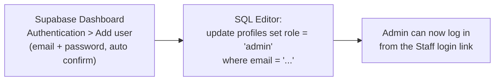

---

## 2. Screen inventory

| ID | Screen | Route | Purpose |
|---|---|---|---|
| A-01 | Admin Login | `/admin/login` | Email + password, no signup |
| A-02 | Forgot Password | `/admin/forgot-password` | Email reset link |
| A-03 | Reset Password | `/admin/reset-password` | Set new password from link |
| A-04 | Dashboard | `/admin/dashboard` | Counts, pending applications, alerts |
| A-05 | Doctor Applications | `/admin/applications` | Pending, Rejected, Approved tabs |
| A-06 | Application Detail | `/admin/applications/:id` | Doctor info and document viewer |
| A-07 | Document Viewer | `/admin/applications/:id/doc/:docId` | Full screen file via signed URL |
| A-08 | Approve Confirm | dialog | Confirm approval |
| A-09 | Reject Sheet | bottom sheet | Reason chips + note |
| A-10 | Doctors List | `/admin/doctors` | Search, filter by status |
| A-11 | Doctor Detail | `/admin/doctors/:id` | Profile, status, patient count, history |
| A-12 | Edit Doctor | `/admin/doctors/:id/edit` | Limited fields (title, clinic, tags) |
| A-13 | Suspend / Reactivate | dialog | Reason, confirm |
| A-14 | Add Doctor (optional) | `/admin/doctors/new` | Direct invite, skips documents |
| A-15 | Patients List | `/admin/patients` | Account info only |
| A-16 | Patient Detail | `/admin/patients/:id` | Name, email, joined, status, linked doctor |
| A-17 | Exercise Library | `/admin/exercises` | All exercises, filters |
| A-18 | Exercise Builder | `/admin/exercises/new` and `/:id/edit` | Create or edit |
| A-19 | Test Exercise | `/admin/exercises/:id/test` | Admin tries tracking on camera |
| A-20 | Notifications | `/admin/notifications` | Inbox |
| A-21 | Audit Log | `/admin/audit` | Who did what, when |
| A-22 | Admin Profile | `/admin/profile` | Name, email, security |
| A-23 | Change Password | `/admin/change-password` | In-app change |
| A-24 | Logout Confirm | dialog | Confirm and sign out |
| A-25 | Inactive / Wrong Portal | `/admin/blocked` | Generic blocked messages |

### 2.1 Navigation map (bottom bar)

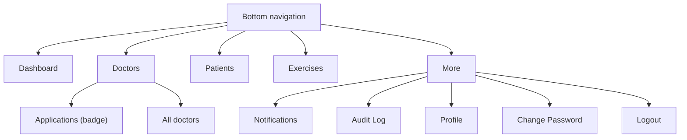

---

## 3. Master flow (Splash to Logout)

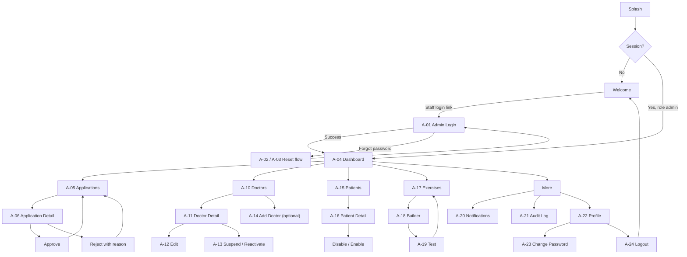

---

## 4. Login (A-01) with all failure paths

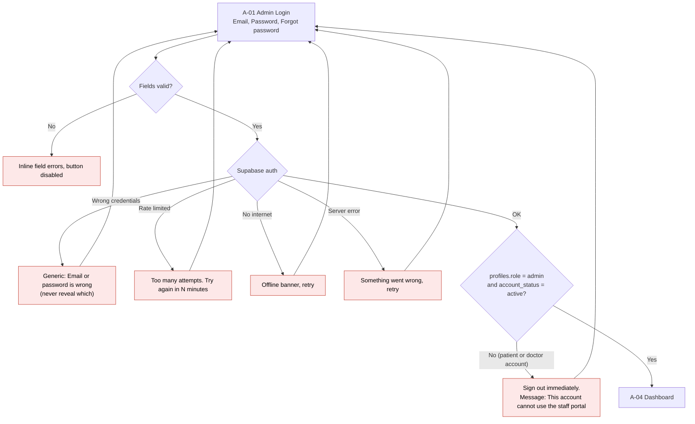

Forgot password: **A-02** (enter email, always the same "if registered, a link was sent" message) then email link opens the app, **A-03** (new password + confirm). Expired link shows "Link no longer works" with a button to request a new one.

---

## 5. Dashboard (A-04)

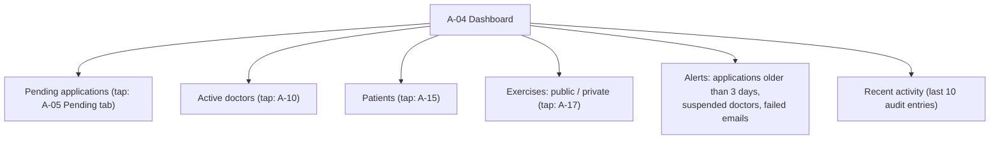

| State | Behaviour |
|---|---|
| Loading | Skeleton tiles |
| Nothing pending | "No applications waiting" |
| Error | "Could not load" + Retry |
| Offline | Cached numbers + offline banner, action buttons disabled |

---

## 6. Doctor application review (core admin task)

### 6.1 Flow

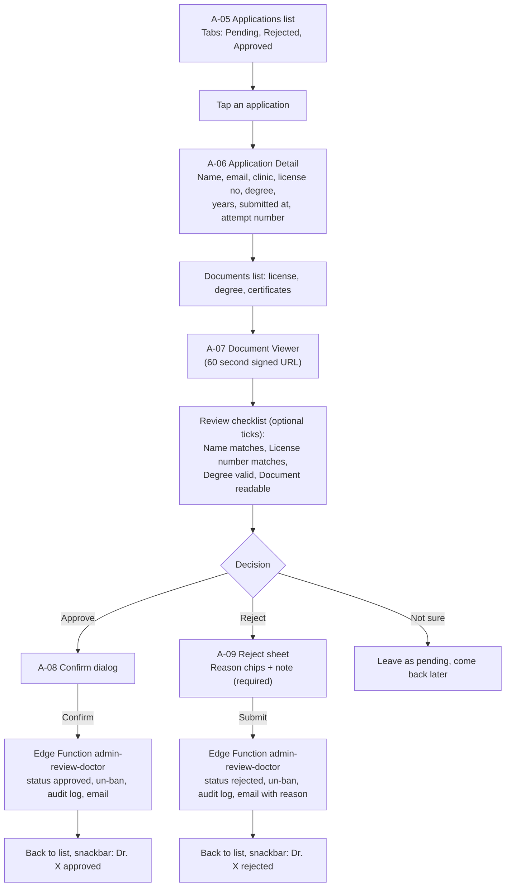

Reject reason chips: *License not readable*, *License number does not match*, *Degree missing or invalid*, *Name mismatch*, *Suspicious document*, *Other* (note required for Other).

### 6.2 Sequence (approve or reject)

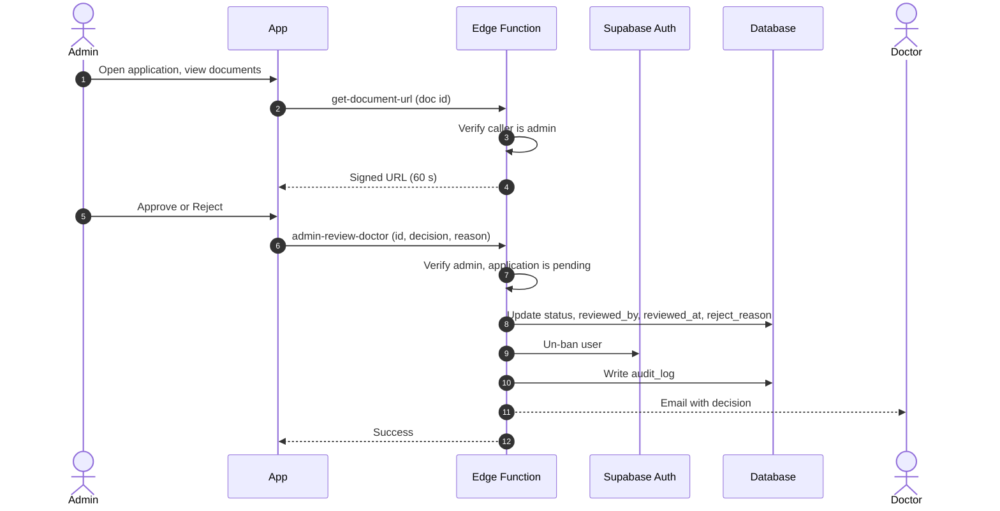

### 6.3 Failure paths

| Failure | What admin sees | Next step |
|---|---|---|
| Another admin already reviewed it | "This application was already reviewed by X" | List refreshes |
| Document URL expired | "Link expired" with Reload button | Tap to get a new URL |
| Document fails to load (corrupt, deleted) | "Could not open file" | Reject with reason "Document not readable" |
| Reject without a reason | Submit disabled | Add reason |
| Email to doctor failed | Decision is saved, banner: "Email not sent" with **Resend** | Resend |
| Network error during decision | "Not saved, try again" (action is idempotent) | Retry |
| Application withdrawn or doctor deleted | "Application no longer exists" | Back to list |

---

## 7. Doctors management

### 7.1 Flow

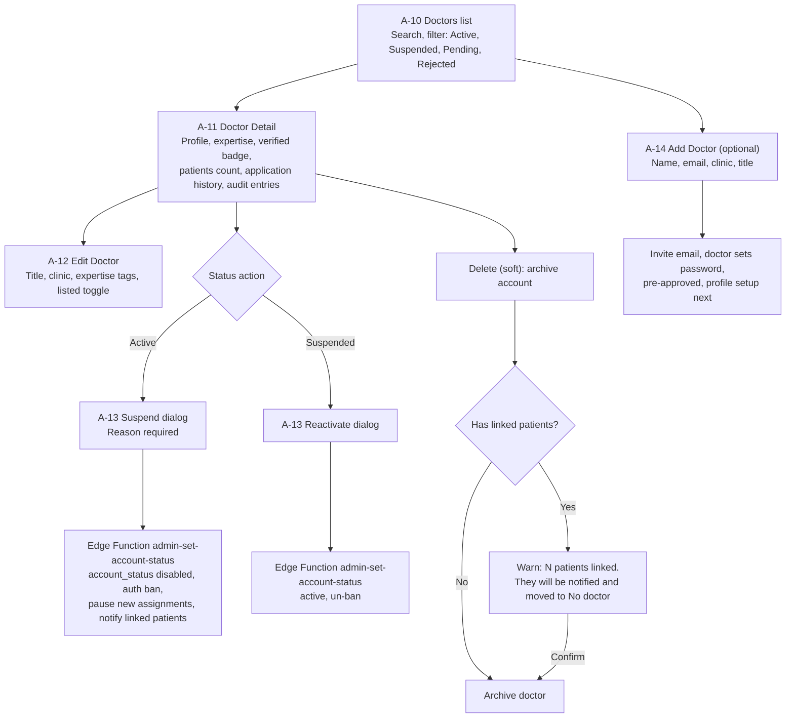

### 7.2 Rules and failures

| Rule or failure | Behaviour |
|---|---|
| Admin cannot suspend or delete **own** account | Button hidden, server also refuses |
| Suspend effect | Doctor cannot log in. Linked patients get "Dr. X is not available". Their existing assignments stay viewable until end date. No new assignments |
| Delete is soft | `account_status = disabled`, `archived_at` set. Sessions and assignments remain |
| Edit changes license or degree | Not allowed here. Doctor must upload new documents (re-review) |
| Add Doctor email already exists | "This email already has an account (patient or doctor)". Never convert a patient |
| Invite email fails | Doctor created as **Invite pending** with Resend button |
| Action fails (network or server) | "Could not save" and status stays unchanged |
| Doctor is currently in the middle of a session review | No effect, they are signed out on the next request |

---

## 8. Patients management

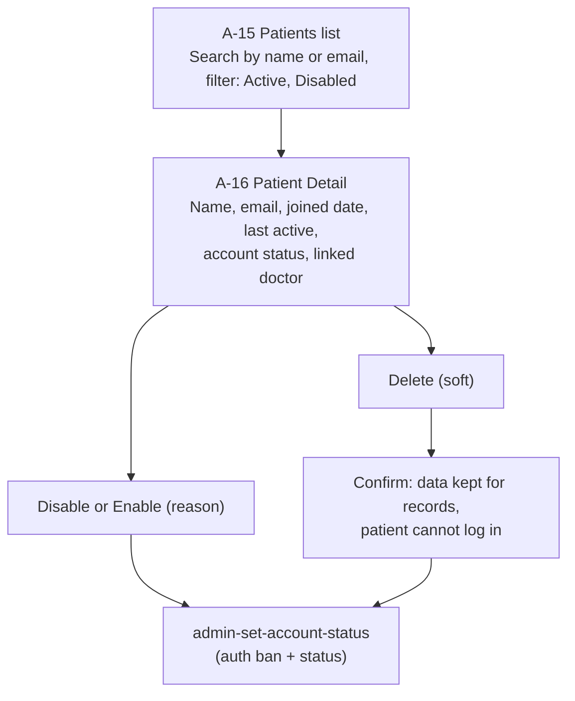

| Rule | Detail |
|---|---|
| Visible | Name, email, joined, last active, status, linked doctor name |
| **Not visible** | Sessions, pain, condition form, progress (health data) |
| Disabled patient | Login shows the generic inactive-account message. Linked doctor is notified |
| Failure | Same pattern: "Could not save, retry". Self-disable not applicable |

---

## 9. Exercise management (admin creates public exercises)

### 9.1 Flow

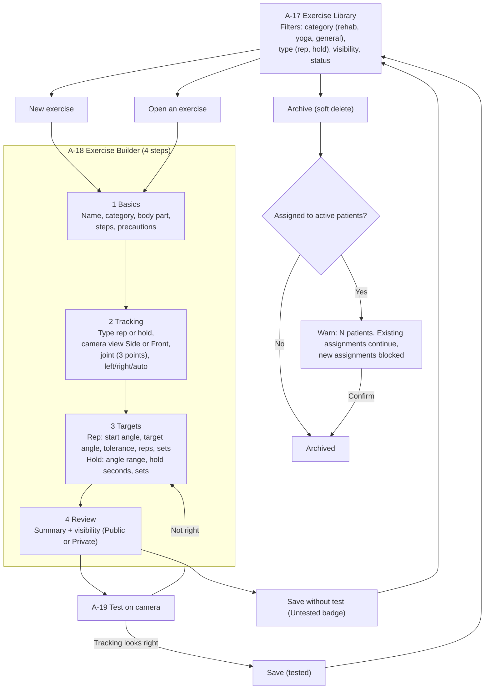

### 9.2 Validation and failures

| Check | Message |
|---|---|
| Name 3 to 60 characters, unique | "Name is too short" or "An exercise with this name exists" |
| At least 2 steps | "Add at least two steps" |
| Start and target angle differ by 20 degrees or more | "Angles are too close to track reliably" |
| Hold: min < max, hold seconds 3 to 120 | Inline errors |
| 2D warning when the movement is toward or away from the camera | Yellow banner: "Depth movement is not tracked well. Choose Side or Front carefully" |
| Save fails or offline | Draft stored locally, "Try again" |
| Leave builder with unsaved changes | "Save draft?" dialog |
| Camera permission denied in test | Camera Help screen |
| Body not in frame during test | "Move back so your whole body is visible" |

Visibility: admin may set **Public** (shown to every patient in the library) or **Private**. Doctors can only create Private exercises.

---

## 10. Common screens

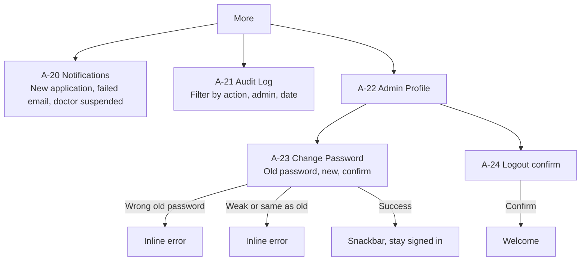

Audit log row: `admin, action, target type, target id, before/after summary, time`. Read-only, no edit or delete.

---

## 11. Global states (every admin screen)

| State | Behaviour |
|---|---|
| Offline | Banner on top, cached data shown, write buttons disabled |
| Session expired | Dialog then Login (unsaved builder draft kept locally) |
| Admin account disabled or role changed | Next request fails, **A-25** generic blocked screen, sign out |
| 403 from a function | "You do not have permission", never raw error text |
| 5xx | "Something went wrong" + Retry |

---

## 12. Admin portal checklist

- [ ] No signup route exists for admin
- [ ] "Staff login" link is small and secondary on Welcome
- [ ] Every admin action goes through an Edge Function that re-checks `is_admin()`
- [ ] Service key never in the app
- [ ] Documents opened only through 60 second signed URLs
- [ ] Audit log written for approve, reject, suspend, reactivate, delete, exercise publish
- [ ] Admin cannot read patient sessions or conditions (RLS)
- [ ] Soft delete everywhere
- [ ] Phase 2: TOTP multi-factor for admin
