# RehabSense: Doctor Portal Architecture

> Scope: everything a doctor or physio does, from Splash to Logout.
> Companion: `SYSTEM_OVERVIEW.md`, `ADMIN_PORTAL.md`, `PATIENT_PORTAL.md`.

---

## 1. Principles

- Doctor **registers publicly** but **cannot log in until the admin approves** (blocked at the auth level).
- Registration is one guided wizard: **account, email OTP, documents, submit**.
- After approval the doctor sets up an **expertise profile** and only then appears to patients.
- A doctor sees **only his own linked patients**. All of this is enforced by RLS (`is_approved_doctor`, `is_linked_doctor`), not only by hiding screens.

---

## 2. Screen inventory

### 2.1 Onboarding and gate screens

| ID | Screen | Route | Purpose |
|---|---|---|---|
| D-01 | Doctor Login | `/doctor/login` | Email + password |
| D-02 | Register: Account | `/doctor/register` | Name, email, password, phone, clinic, license number |
| D-03 | Register: Verify Email | `/doctor/verify-email` | OTP code (same as patient app) |
| D-04 | Register: Documents | `/doctor/documents` | License, degree, certificates |
| D-05 | Register: Review and Submit | `/doctor/submit` | Summary, declaration, submit |
| D-06 | Application Submitted | `/doctor/submitted` | Signed out, what happens next |
| D-07 | Resume Application | `/doctor/resume` | For `incomplete` status |
| D-08 | Application Rejected | `/doctor/rejected` | Reason, resubmit |
| D-09 | Inactive Account | `/doctor/inactive` | Generic blocked message |
| D-10 | Forgot Password | `/doctor/forgot-password` | Email |
| D-11 | Reset Password | `/doctor/reset-password` | New password |
| D-12 | Profile Setup (wizard) | `/doctor/setup` | Expertise, bio, experience, clinic, availability |
| D-13 | Profile Preview and Go Live | `/doctor/setup/preview` | How patients see you, toggle listed |

### 2.2 Main portal screens

| ID | Screen | Route |
|---|---|---|
| D-14 | Home Dashboard | `/doctor/home` |
| D-15 | Patient Requests | `/doctor/requests` |
| D-16 | Request Detail | `/doctor/requests/:id` |
| D-17 | My Patients | `/doctor/patients` |
| D-18 | Patient Detail | `/doctor/patients/:pid` |
| D-19 | Assign Exercise (3 steps) | `/doctor/patients/:pid/assign` |
| D-20 | Exercise Library | `/doctor/exercises` |
| D-21 | Exercise Builder | `/doctor/exercises/new` |
| D-22 | Test Exercise | `/doctor/exercises/:id/test` |
| D-23 | Session Review and Feedback | `/doctor/patients/:pid/sessions/:sid` |
| D-24 | Invite Code (optional) | `/doctor/invite` |
| D-25 | Notifications | `/doctor/notifications` |
| D-26 | Doctor Profile | `/doctor/profile` |
| D-27 | Edit Profile and Expertise | `/doctor/profile/edit` |
| D-28 | Update Credentials (re-review) | `/doctor/profile/credentials` |
| D-29 | Settings, Change Password, Notification Prefs | `/doctor/settings` |
| D-30 | Logout Confirm | dialog |

### 2.3 Navigation map (bottom bar)

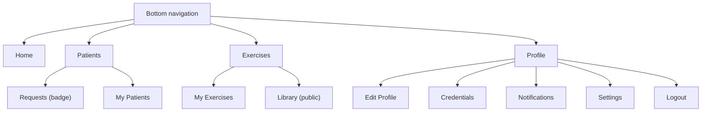

---

## 3. Master flow (Splash to Logout)

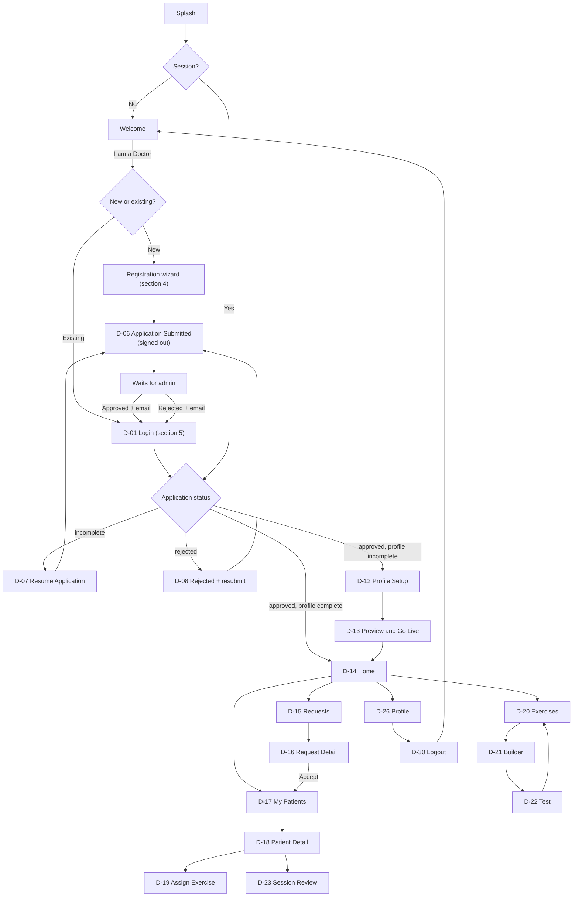

---

## 4. Registration wizard (signup to submit)

### 4.1 Flow

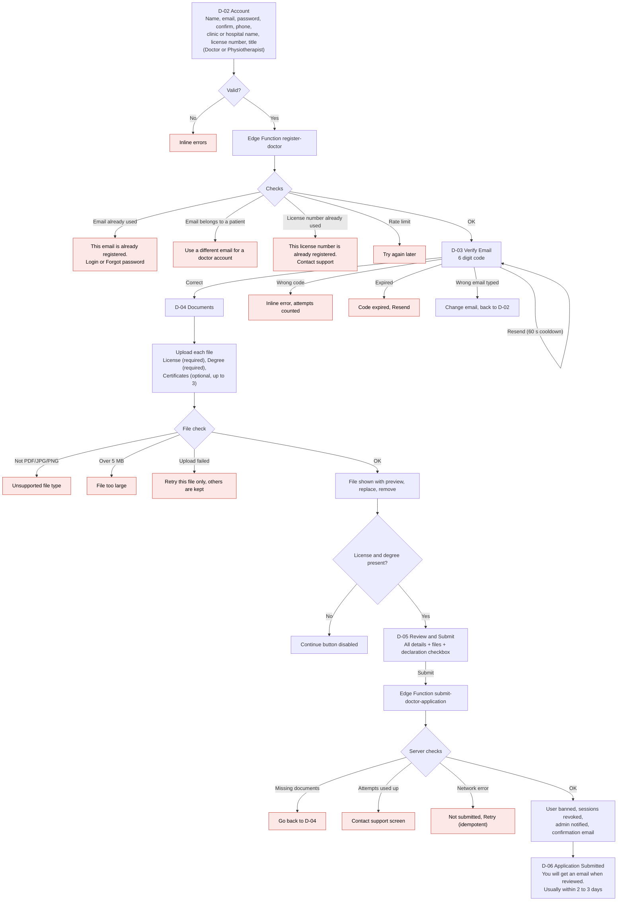

### 4.2 Interrupted registration (user closes the app)

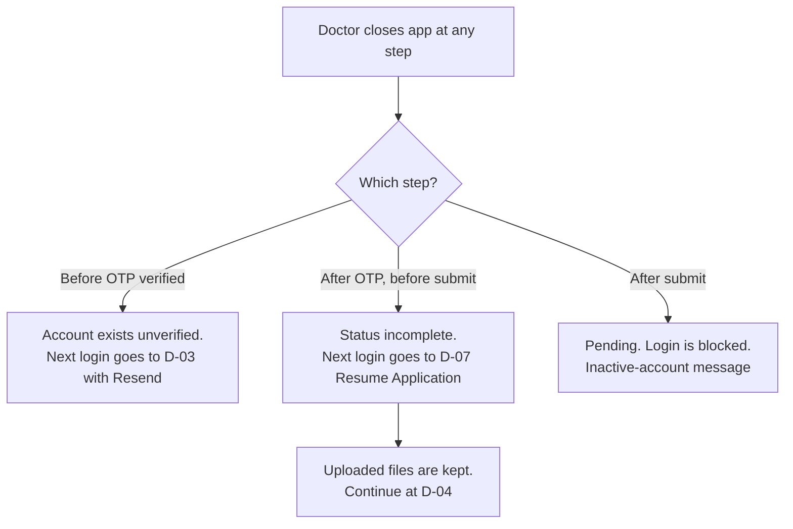

### 4.3 Field rules

| Field | Rule |
|---|---|
| Name | 3 to 60 characters |
| Email | Valid, unique, not a patient email |
| Password | 8 or more characters, 1 number |
| License number | Required, unique among non-rejected applications |
| Clinic or hospital | Required |
| Documents | License and degree required, 5 MB, PDF/JPG/PNG |
| Declaration | "I confirm these documents are genuine" must be ticked |

---

## 5. Login (D-01) and the status gate

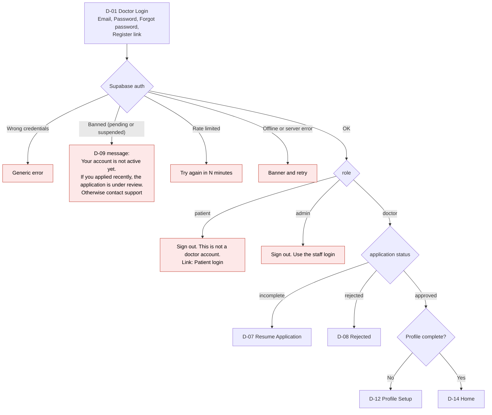

Forgot password: **D-10** (enter email, same generic message) then email link, **D-11** (new password), then Login. Expired link: "Link no longer works, request a new one". A banned (pending) doctor can request a reset email but still cannot log in.

---

## 6. Rejected application and resubmission

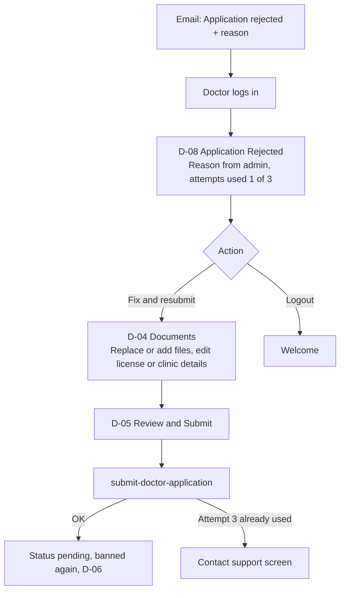

While rejected, the doctor has access to **only** D-08, D-04, D-05 and logout. RLS returns nothing for patients, requests or exercises.

---

## 7. Profile setup after approval (D-12, D-13)

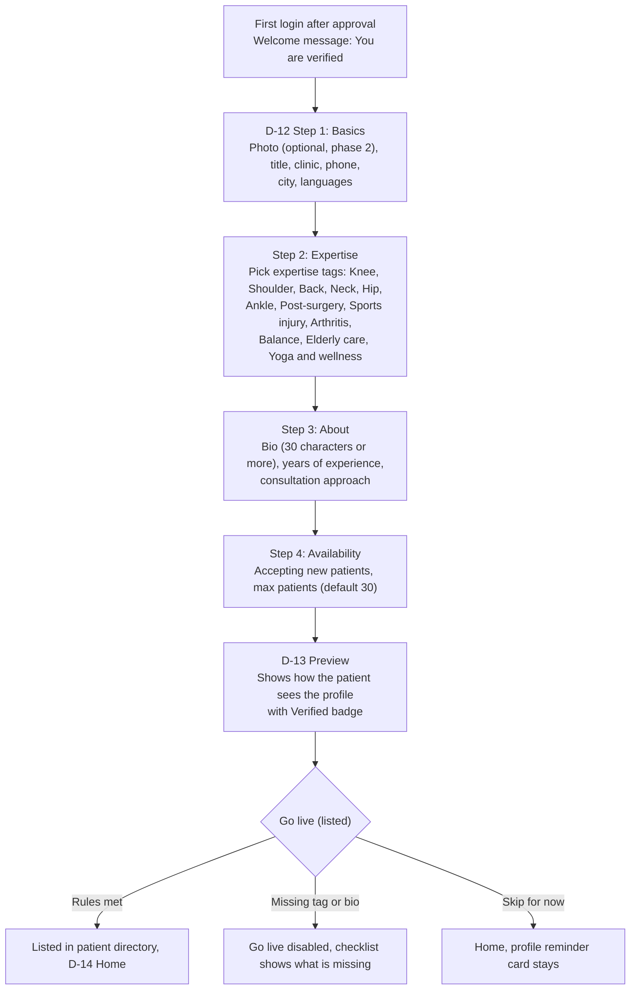

Listed rule: **approved + at least 1 expertise tag + bio 30+ characters + clinic + accepting patients**. Doctor can leave and resume setup at any time (draft saved).

Failures: validation errors inline; save failure shows "Not saved, retry" and keeps typed data; offline shows banner and disables Save.

---

## 8. Home (D-14)

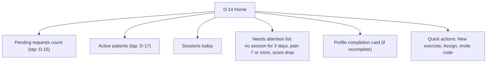

| State | Behaviour |
|---|---|
| New doctor, no patients | "No patients yet. Complete your profile so patients can find you" + button |
| Loading | Skeleton |
| Error | Retry |
| Offline | Cached data + banner |

---

## 9. Patient requests

### 9.1 Flow

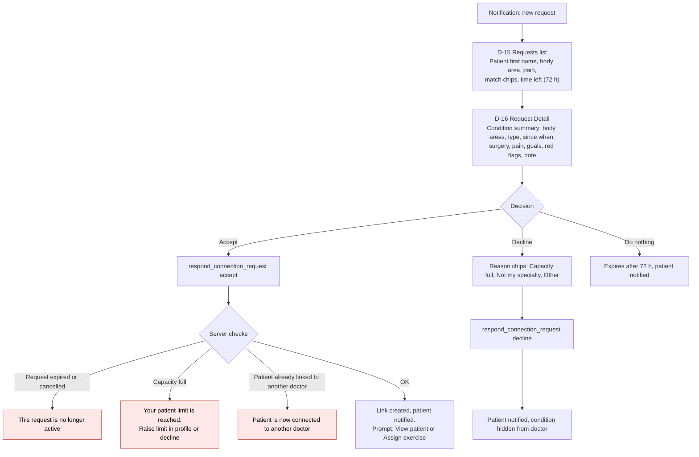

### 9.2 Rules

| Rule | Detail |
|---|---|
| Condition visibility | Only to the doctor who received the request, and only while `pending` or `accepted` |
| Red flags | Shown prominently (numbness, chest pain, fever with swelling, cannot bear weight) |
| Action buttons | Idempotent: double tap or retry never creates two links |
| Network error | "Not saved, try again" and request stays pending |
| Reminder | Doctor gets a notification 24 hours before expiry |

---

## 10. Patient management and assigning exercises

### 10.1 Patient list and detail

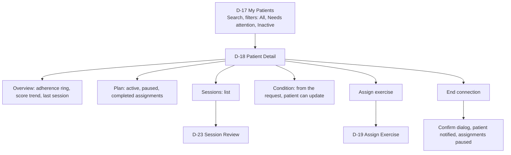

| Edge | Behaviour |
|---|---|
| Patient disconnected while doctor is on the screen | "This patient is no longer connected", back to list |
| Sessions empty | "No sessions yet" |
| RLS returns nothing | Same friendly message, never a raw error |

### 10.2 Assign exercise (D-19)

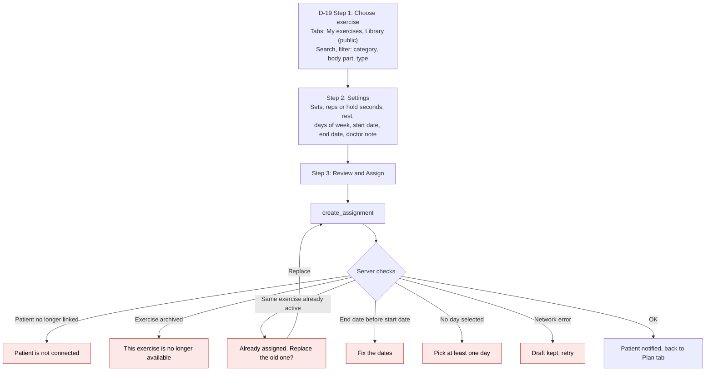

Leaving the wizard with unsaved changes shows "Discard draft?".

---

## 11. Exercise creation (doctor)

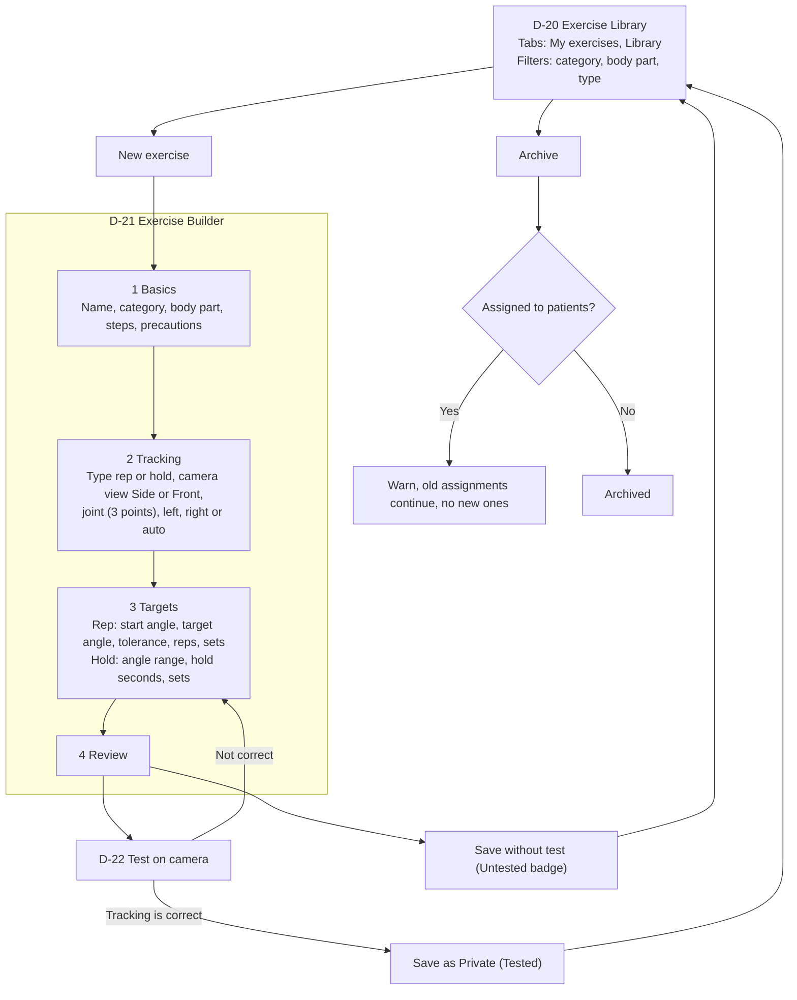

Doctor exercises are **always Private** (only his own patients can see them). Only admin can make an exercise Public. Same validations as the admin builder: unique name, 2 or more steps, angles 20 degrees apart, hold range valid, 2D depth warning. Draft is saved locally on failure.

Test failures: camera permission denied (Camera Help), body out of frame ("Move back"), low landmark confidence ("Improve lighting"), camera crash (Camera Error screen).

---

## 12. Session review and feedback (D-23)

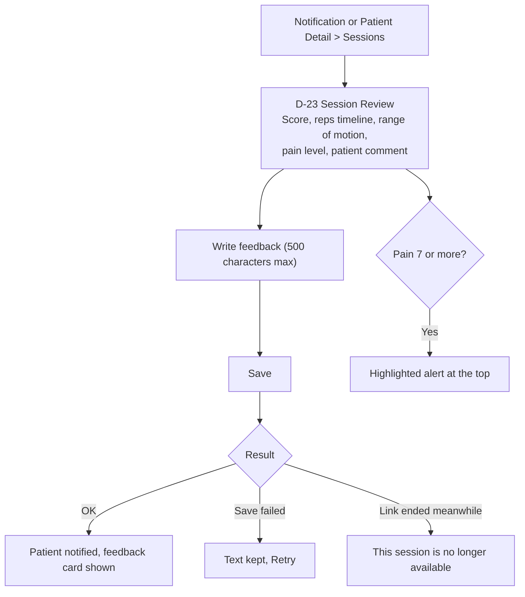

---

## 13. Profile, credentials, settings and logout

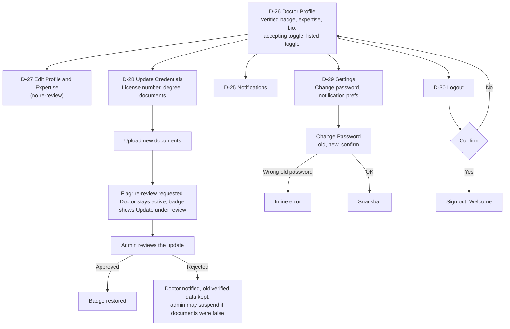

---

## 14. Optional: invite code (D-24)

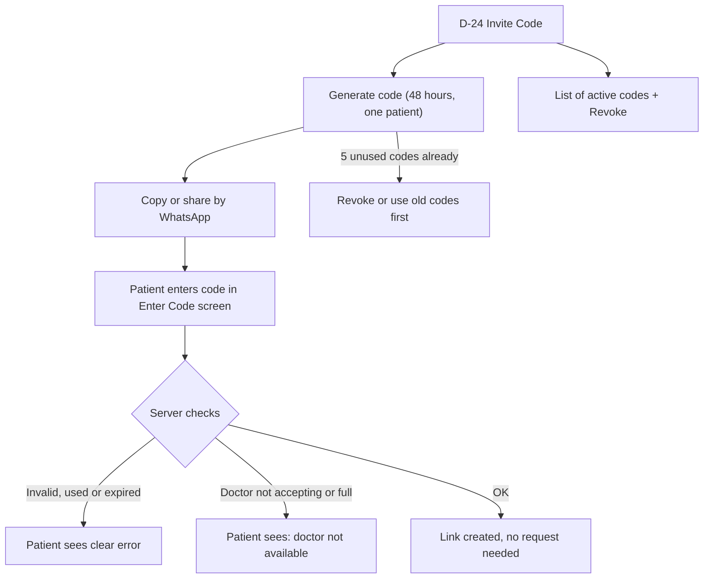

This is a convenience path for patients the doctor already knows. It can be built in a later phase.

---

## 15. Suspension and global states

### 15.1 If the admin suspends this doctor

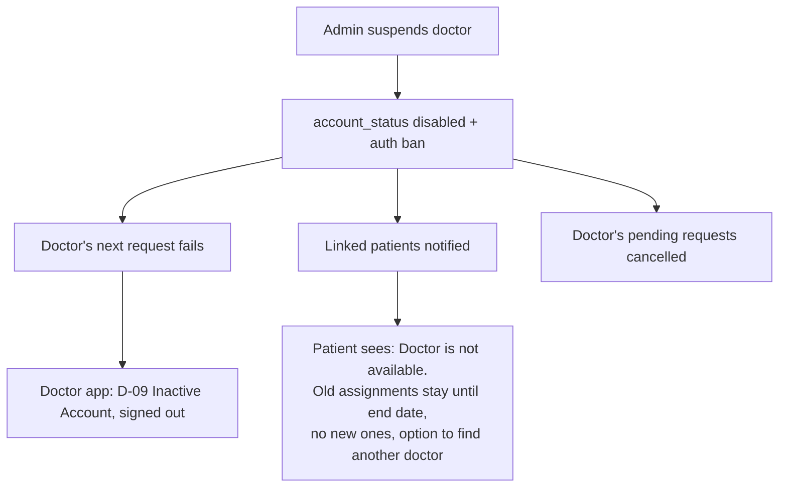

### 15.2 Global states (every doctor screen)

| State | Behaviour |
|---|---|
| Offline | Banner, cached data, write buttons disabled, drafts kept locally |
| Session expired | Dialog then login, drafts kept |
| Status changed by admin while using the app | Next request fails, routed by the gate |
| 403 | "You do not have permission", no raw error |
| 5xx | "Something went wrong" + Retry |

---

## 16. Doctor portal checklist

- [ ] No doctor can log in while `pending` (auth ban) or `suspended`
- [ ] `incomplete` doctor resumes at documents, nothing else is reachable
- [ ] `rejected` doctor reaches only D-08, D-04, D-05
- [ ] Every doctor RLS policy uses `is_approved_doctor()` and `is_linked_doctor()`
- [ ] Documents bucket is private, doctor can write only while `incomplete` or `rejected`
- [ ] License number uniqueness enforced on the server
- [ ] Doctor exercises are Private only
- [ ] Condition data hidden after decline, expiry, cancel or disconnect
- [ ] Credentials change triggers re-review without locking the doctor out
