# RehabSense: Patient Portal Architecture

> Scope: everything a patient does, from Splash to Logout.
> Companion: `SYSTEM_OVERVIEW.md`, `DOCTOR_PORTAL.md`, `ADMIN_PORTAL.md`.
> The existing patient app (from `PROJECT_HANDOFF.md`) stays as it is. **New or changed** parts are marked **[NEW]** or **[CHANGED]**.

---

## 1. Principles

- A patient can use the app **fully without a doctor**: Wellness/Yoga and Rehab library, camera tracking, progress.
- Connecting to a doctor is **optional**. The **Prescribed** container is always visible but **locked until a doctor is connected**. Tapping a locked card opens the Connect flow, never a dead end.
- Patient signup is public, with email OTP verification and **no approval wait**.
- Patient picks the doctor: fills a **condition form**, sees doctors **sorted by expertise match**, sends a request. The doctor accepts or declines.
- Only the doctor who receives the request (and later the connected doctor) sees the condition and sessions.

---

## 2. Screen inventory

### 2.1 Existing screens (unchanged unless marked)

| ID | Screen | Route | Note |
|---|---|---|---|
| P-01 | Splash | `/splash` | Runs the Login Gate |
| P-02 | Welcome | `/welcome` | Patient buttons, small Doctor link, tiny Staff link |
| P-03 | Login | `/login` | |
| P-04 | Register | `/register` | |
| P-05 | Verify Email (OTP) | `/verify-email` | |
| P-06 | Forgot Password | `/forgot-password` | |
| P-07 | Reset Password | `/reset-password` | |
| P-08 | Profile Setup | `/setup/profile` | |
| P-09 | Safety Consent | `/setup/consent` | |
| P-10 | Camera Help | `/setup/camera-help` | |
| P-11 | Home | `/home` | **[CHANGED]** Prescribed container |
| P-12 | Courses | `/courses` | **[CHANGED]** 3 segments |
| P-13 | Course Detail | `/courses/:id` | |
| P-14 | Exercise Detail | `/courses/:cid/exercise/:eid` | |
| P-15 | Checklist | `/session/checklist` | |
| P-16 | Camera Setup | `/session/camera-setup` | Shows Side or Front instruction |
| P-17 | Live Tracking | `/session/live` | **[CHANGED]** config-based, rep and hold |
| P-18 | Pause | overlay | |
| P-19 | Summary | `/session/summary` | **[CHANGED]** pain and comment for prescribed |
| P-20 | Saved | `/session/saved` | |
| P-21 | Camera Error | `/session/camera-error` | |
| P-22 | Sync Error | `/session/sync-error` | |
| P-23 | Progress Dashboard | `/progress` | |
| P-24 | Exercise Progress | `/progress/exercise/:id` | |
| P-25 | Session History | `/progress/history` | |
| P-26 | Session Details | `/progress/session/:id` | **[CHANGED]** doctor feedback card |
| P-27 | Notification Inbox | `/notifications` | **[CHANGED]** new types |
| P-28 | Profile | `/profile` | **[CHANGED]** My Doctor row |
| P-29 | Edit Profile | `/profile/edit` | |
| P-30 | Settings | `/profile/settings` | |
| P-31 | Change Password | `/profile/change-password` | |
| P-32 | Notification Prefs | `/profile/notifications` | |
| P-33 | Help | `/profile/help` | |
| P-34 | Privacy | `/profile/privacy` | |
| P-35 | About | `/profile/about` | |
| P-36 | Logout Confirm | dialog | |

### 2.2 New screens [NEW]

| ID | Screen | Route |
|---|---|---|
| P-37 | Connect Hub | `/connect` |
| P-38 | Condition Form (3 steps) | `/connect/condition` |
| P-39 | Safety Alert | sheet |
| P-40 | Find Doctors (matched list) | `/connect/doctors` |
| P-41 | Doctor Public Profile | `/connect/doctors/:id` |
| P-42 | Send Request | `/connect/doctors/:id/request` |
| P-43 | Request Status | `/connect/status/:rid` |
| P-44 | Connected (celebration) | `/connect/connected` |
| P-45 | Request Declined or Expired | `/connect/result/:rid` |
| P-46 | My Doctor | `/profile/doctor` |
| P-47 | Disconnect Confirm | dialog |
| P-48 | Prescribed List | `/courses/prescribed` |
| P-49 | Prescribed Exercise Detail | `/prescribed/:assignmentId` |
| P-50 | Enter Doctor Code (optional) | `/connect/code` |
| P-51 | My Condition (view and edit) | `/profile/condition` |
| P-52 | Inactive Account | `/account-inactive` |

### 2.3 Navigation map (bottom bar)

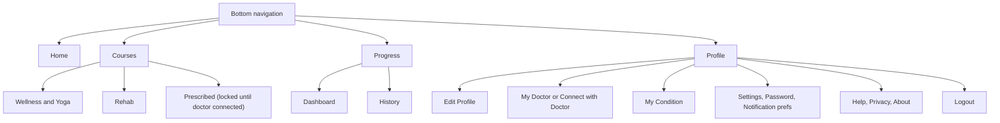

---

## 3. Master flow (Splash to Logout)

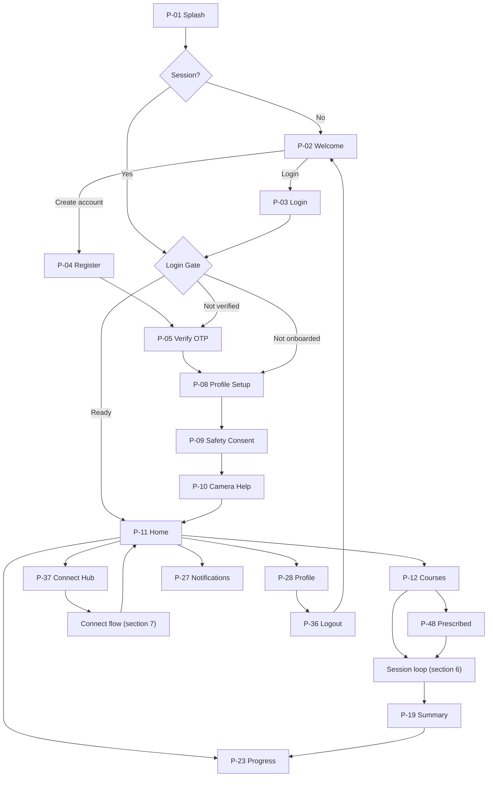

---

## 4. Authentication flows

### 4.1 Register and verify

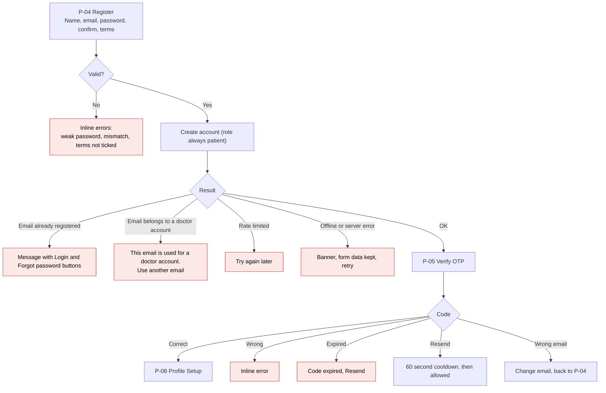

### 4.2 Login

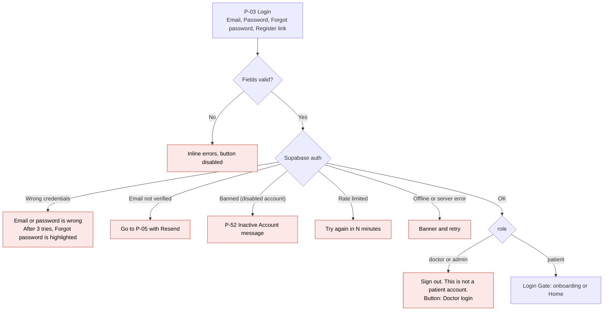

### 4.3 Forgot and reset password

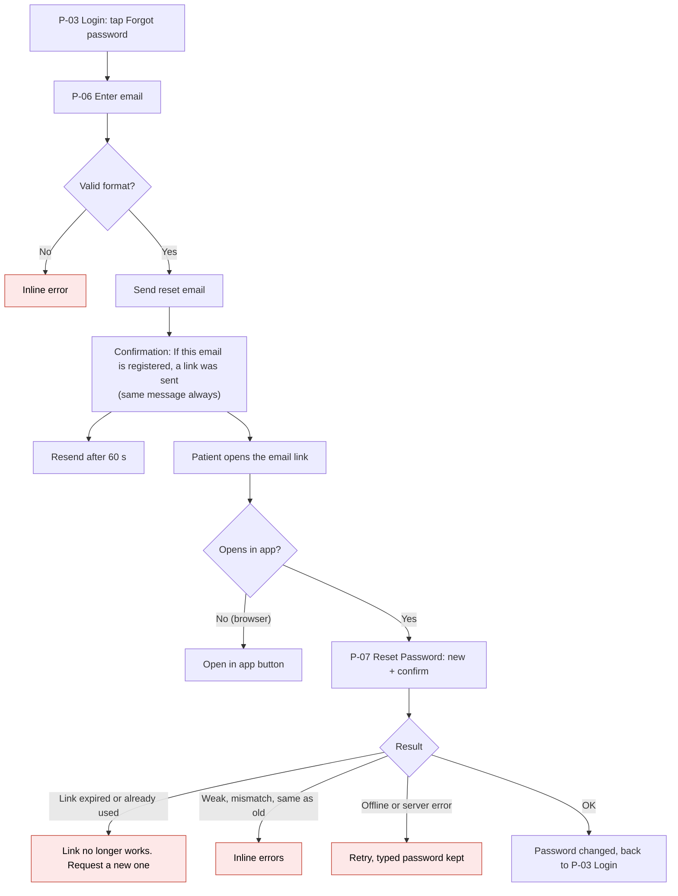

### 4.4 Onboarding

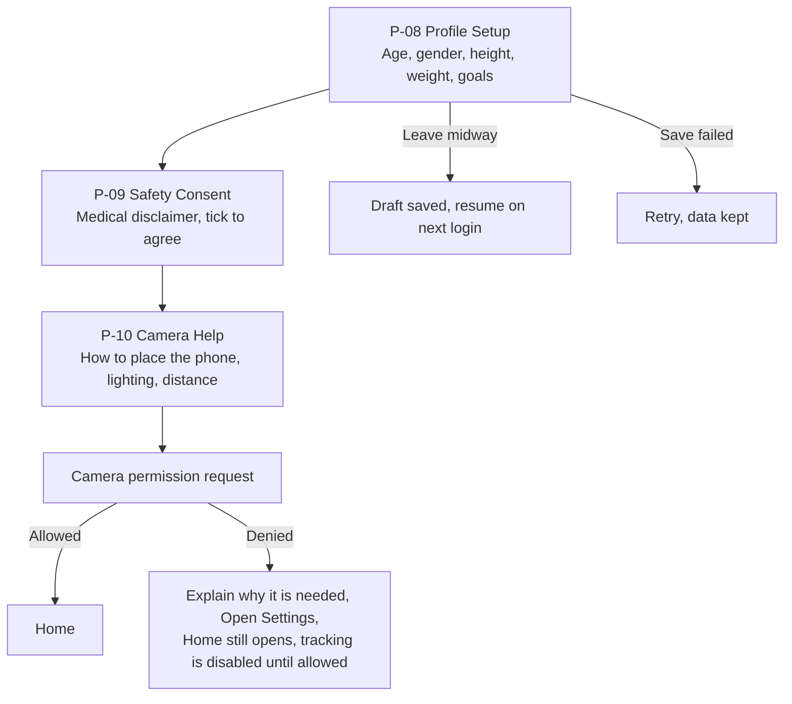

Onboarding completion is stored as `profiles.onboarded_at`, so logging in on another phone does not repeat it.

---

## 5. Home and Courses [CHANGED]

### 5.1 Home with the Prescribed container

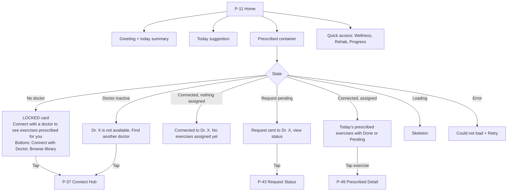

### 5.2 Courses (3 segments)

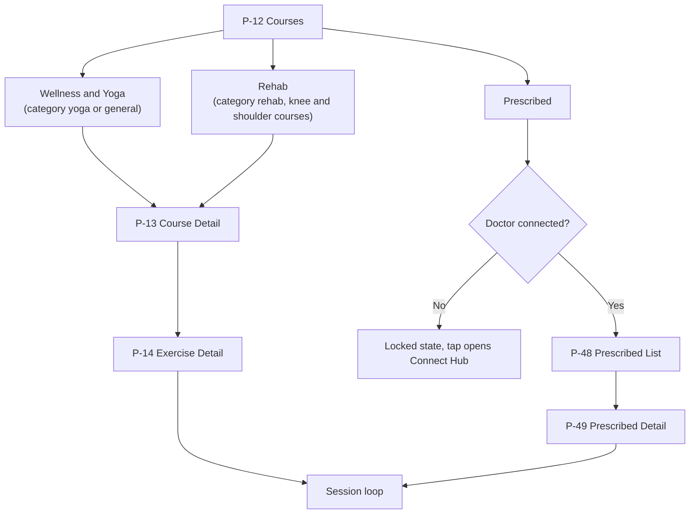

---

## 6. Session loop (core exercise flow)

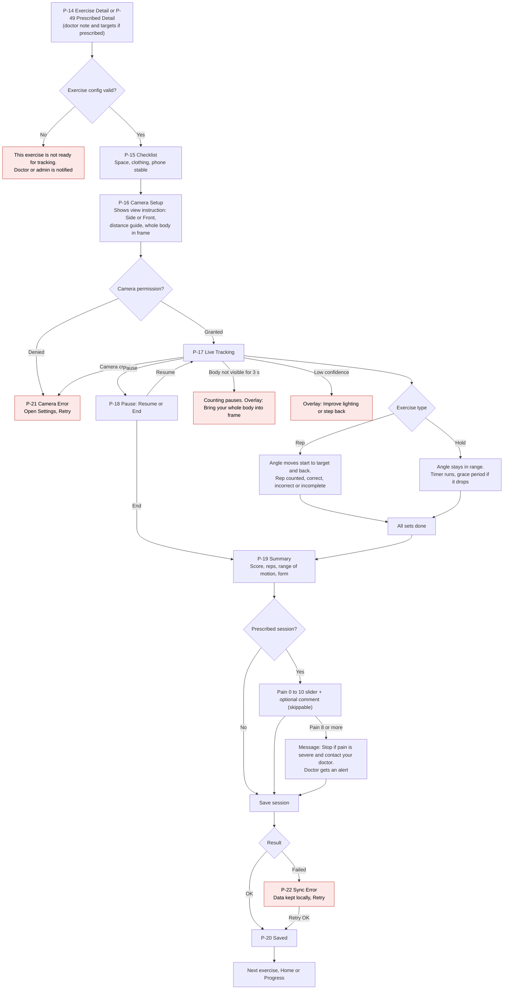

Rules: tracking uses **2D (x, y) angles only**. No video is recorded or uploaded. A prescribed session is saved with its `assignment_id`.

---

## 7. Connect with a doctor [NEW]

### 7.1 Flow

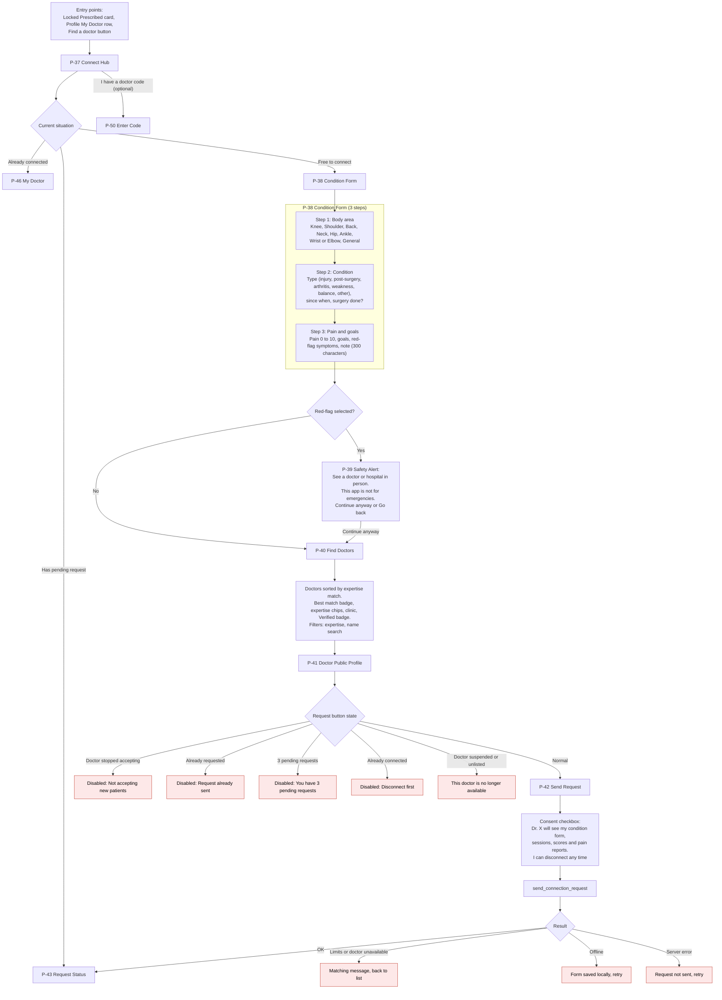

### 7.2 Find Doctors states

| State | Behaviour |
|---|---|
| Loading | Skeleton cards |
| No doctors at all | "No doctors available right now" + **Enter code** and **Browse library** |
| No match for filters | "No doctors found" + Clear filters |
| Expertise match | Doctors with the most matching tags first, ties broken by free capacity |
| Offline | Cached list, Request button disabled |
| Error | Retry |

Matching note: this is a convenience sort, not medical advice. The screen shows "Choose the doctor you feel is right for you".

### 7.3 Request Status and result (P-43, P-44, P-45)

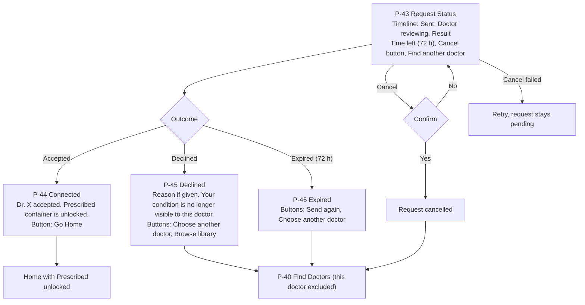

Rules: max **3 pending requests**, one request per doctor at a time, **one active doctor** per patient. When one request is accepted, the patient's other pending requests are cancelled automatically. Status changes arrive by notification and by auto-refresh.

### 7.4 Optional: Enter Doctor Code (P-50)

| Failure | Message |
|---|---|
| Wrong code | "This code is not valid" |
| Expired | "This code expired. Ask your doctor for a new one" |
| Already used | "This code was already used" |
| Doctor full or not available | "This doctor is not accepting patients" |
| Already connected | "Disconnect from your current doctor first" |
| 5 wrong codes | Locked for 15 minutes |
| Success | Confirmation sheet showing what the doctor will see, then P-44 |

---

## 8. Prescribed exercises [NEW]

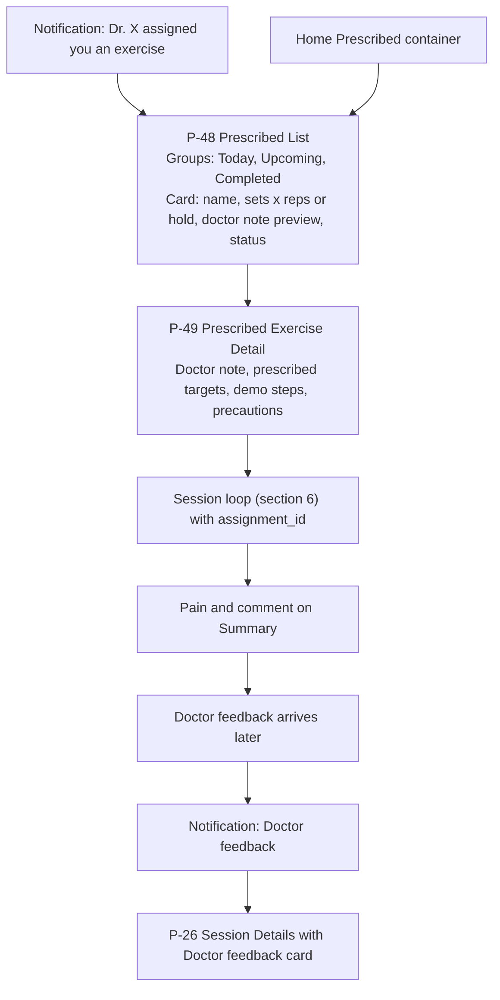

| Edge | Behaviour |
|---|---|
| Assignment end date passed | Moves to Completed |
| Doctor cancelled or updated the plan while the list is open | Refresh removes or updates the card, snackbar "Your doctor updated your plan" |
| Exercise archived afterwards | Card disabled "This exercise is no longer available" |
| Doctor suspended | Banner, old assignments stay until end date, no new ones |
| Fetch error | Retry |
| Config broken | "This exercise is not ready for tracking" |

---

## 9. My Doctor and disconnect [NEW]

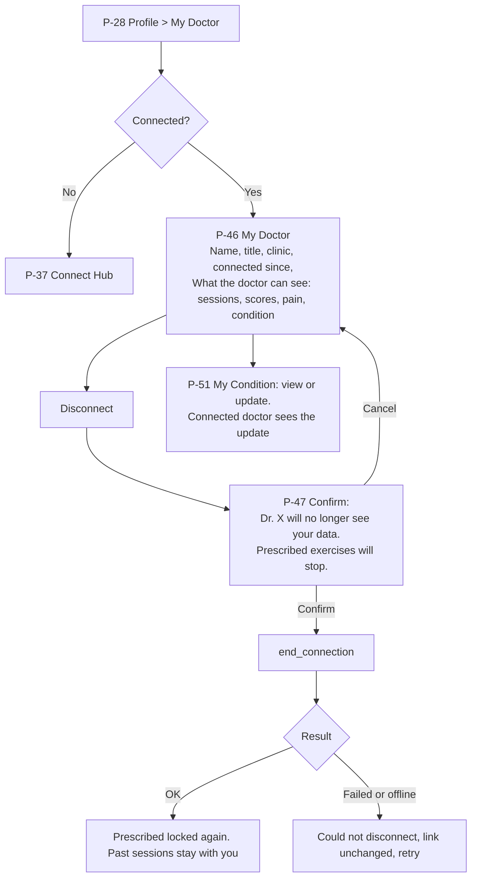

---

## 10. Progress, notifications, profile and logout

### 10.1 Progress

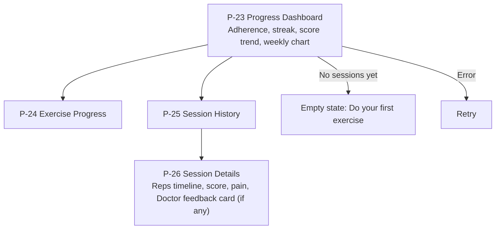

### 10.2 Notifications

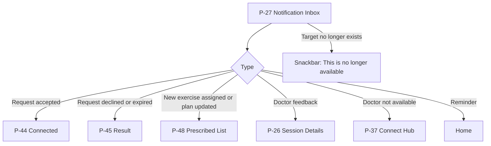

### 10.3 Profile and logout

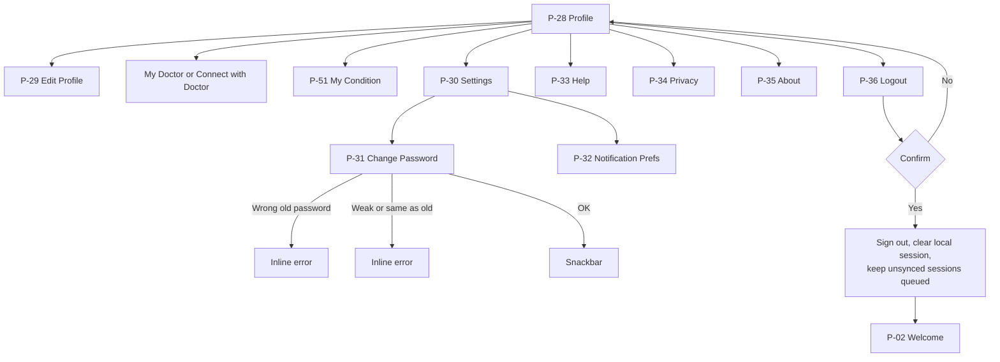

---

## 11. Global states (every patient screen)

| State | Behaviour |
|---|---|
| Offline | Banner, cached data, write actions disabled, sessions queue locally and sync later |
| Session expired | Dialog, then Login. Unsynced sessions are kept |
| Account disabled by admin | Next request fails, **P-52 Inactive Account**, signed out |
| Doctor suspended or deleted | Banner on Home and My Doctor, option to find another doctor |
| Doctor ended the connection | Notification, Prescribed locked again, past data stays with the patient |
| 403 from server | "You do not have permission", no raw error text |
| 5xx | "Something went wrong" + Retry |

---

## 12. Patient privacy rules

| Rule | Detail |
|---|---|
| Condition form | Seen only by the doctor who received the request. Hidden after decline, expiry, cancel or disconnect |
| Sessions, pain, scores | Seen only by the currently connected doctor |
| Admin | Sees account info only (name, email, status, linked doctor), never health data |
| Video | Never recorded or stored |
| Disconnect | Patient can disconnect any time, data stays with the patient |
| Directory | Patient sees only approved, listed doctors (view hides email and phone) |

---

## 13. Patient portal checklist

- [ ] Patient signup can never create a doctor or admin (role forced server side)
- [ ] Prescribed container visible but locked until connected, tap opens Connect Hub
- [ ] App works fully without a doctor
- [ ] Max 3 pending requests, 72 hour expiry, one active doctor
- [ ] Condition form has red-flag Safety Alert
- [ ] Consent shown before a request is sent
- [ ] Doctor directory shows only approved and listed doctors
- [ ] Offline sessions queue and sync later
- [ ] Onboarding flag stored on the server
