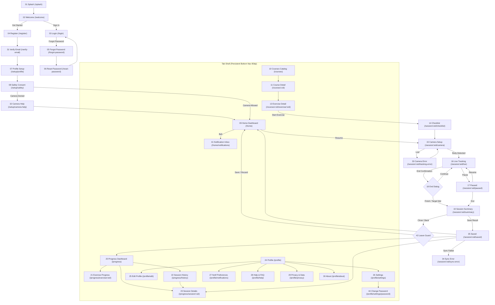

# PROJECT HANDOFF: RehabSense (shariq_skeleton)

> **Document Purpose**: Complete technical and architectural handoff documentation for **RehabSense**. Designed to enable any AI agent or software engineer to understand, maintain, test, and extend the existing codebase without rewriting or guessing any architectural decisions.  
> **Source Base**: Audited directly from the Flutter codebase, `DESIGN.md`, `pubspec.yaml`, `supabase_schema.sql`, and repository commit history.  
> **Date**: November 2026  
> **Audited By**: Antigravity AI Engineering

---

## 1. PROJECT OVERVIEW

- **Application Name**: RehabSense (Internal project package name: `shariq_skeleton`, Android application ID: `com.example.my_app`).
- **Core Purpose**: Smartphone-camera-guided physiotherapy and musculoskeletal rehabilitation. The application uses on-device computer vision and MediaPipe pose detection to track body landmarks, verify posture alignment, count repetitions, provide single-line real-time corrective feedback, and log movement quality scores so recovering patients can track their functional rehabilitation safely at home.
- **Target Users**: Patients recovering from joint injuries, surgeries, or mobility impairments (specifically knee rehabilitation and shoulder mobility), as well as general posture/balance rehabilitation patients.
- **Target Platforms**:
  - **Android**: Primary production target (`android-first`). Configured with native camera view and Google MediaPipe (`minSdk` per Flutter SDK, targeting modern Android).
  - **iOS**: Secondary mobile target. Platform view hooks (`UiKitView`) are defined in `lib/domain/pose/pose_tracker.dart`.
  - **Desktop / Web (Windows, macOS, Linux, Web)**: Development & preview environments. Live camera preview falls back to a placeholder backdrop (`lib/domain/pose/pose_tracker.dart#L248-L257`), as native MediaPipe platform views require Android or iOS.
- **Current State Summary**:  
  RehabSense is a working Flutter client with a 4-tab shell architecture (`Home`, `Courses`, `Progress`, `Profile`) and a full-screen camera exercise pipeline. It integrates Supabase authentication (sign up, sign in, sign out, password recovery) and contains a complete on-device pose-tracking engine (`lib/domain/pose/pose_tracker.dart`, `lib/features/session/live_tracking_screen.dart`) that calculates 8 joint angles, detects rep cycles using a knee angle state machine, checks posture levelness (shoulder/hip tilt, trunk lean), issues haptic feedback, displays live movement scores (0–100), and records sessions with per-rep outcomes (`Correct`, `Incorrect`, `Incomplete`). The data layer operates with in-memory repositories (`CourseRepository`, `SessionRepository`, `UserRepository`, `NotificationRepository`) backed by comprehensive seed data, while a full Supabase PostgreSQL schema (`supabase_schema.sql`) is authored and ready for production synchronization.

---

## 2. TECH STACK

### 2.1 Core Technologies & Runtimes
| Category | Technology | Version | Location / Source |
|---|---|---|---|
| **Language** | Dart | `^3.11.5` (`3.11.5` active) | `pubspec.yaml#L8`, `flutter --version` |
| **Framework** | Flutter SDK | `3.41.9` (Channel stable) | `flutter --version` |
| **Target OS / Build** | Android (Kotlin / Gradle KTS) | compileSdk, JVM 17 | `android/app/build.gradle.kts#L14-L20` |
| **State Management** | Flutter Riverpod / Stateful Widgets | `flutter_riverpod: ^2.6.1` (imported, stateful widgets currently used across screens) | `pubspec.yaml#L16` |
| **Routing & Navigation** | GoRouter | `^15.1.2` | `pubspec.yaml#L15`, `lib/app/router.dart` |
| **Design System** | Custom Material 3 + Custom Tokens | Material 3 enabled | `lib/app/theme/app_theme.dart#L6` |
| **Backend as a Service** | Supabase | `supabase_flutter: ^2.18.3` | `pubspec.yaml#L25`, `lib/core/supabase_config.dart` |
| **Database** | Supabase PostgreSQL | Remote Cloud Instance | `supabase_schema.sql`, `lib/core/supabase_config.dart` |
| **Local Storage / Caching** | Shared Preferences / In-Memory Repositories | `shared_preferences: ^2.3.4` | `pubspec.yaml#L17`, `lib/data/repositories/repositories.dart` |
| **Pose Detection & Camera** | MediaPipe Pose Landmarker | Custom Git: `flutter_mp_pose_landmarker` | `pubspec.yaml#L22-L24`, `lib/domain/pose/pose_tracker.dart` |
| **Typography** | Google Fonts (Inter) | `google_fonts: ^6.2.1` | `pubspec.yaml#L20`, `lib/core/tokens.dart#L62` |
| **Iconography** | Lucide Icons | `lucide_icons: ^0.257.0` | `pubspec.yaml#L18` |
| **Internationalization** | Intl | `intl: ^0.20.2` | `pubspec.yaml#L19` |

### 2.2 Complete Dependency Breakdown (`pubspec.yaml`)
| Package | Version | Purpose in Codebase |
|---|---|---|
| `flutter` | SDK | Core Flutter framework (`pubspec.yaml#L11`). |
| `cupertino_icons` | `^1.0.8` | iOS style icon assets (`pubspec.yaml#L14`). |
| `go_router` | `^15.1.2` | Declarative routing with `StatefulShellRoute.indexedStack` preserving 4 tab branches and root modals (`lib/app/router.dart`). |
| `flutter_riverpod` | `^2.6.1` | Reactive state management dependency declared in `pubspec.yaml#L16`. |
| `shared_preferences` | `^2.3.4` | Device local key-value store for offline persistence and consent flags (`pubspec.yaml#L17`). |
| `lucide_icons` | `^0.257.0` | Unified outline icon set (24px, stroke 1.75) used on all buttons, tabs, chips, and headers (`pubspec.yaml#L18`). |
| `intl` | `^0.20.2` | Date/time formatting for notification items and session history timestamps (`pubspec.yaml#L19`, `lib/features/home/notification_inbox_screen.dart#L3`). |
| `google_fonts` | `^6.2.1` | Inter typography rendering across all token text styles (`pubspec.yaml#L20`, `lib/core/tokens.dart#L7`). |
| `flutter_mp_pose_landmarker` | Git repo | On-device Google MediaPipe pose landmark stream, platform camera preview (`camera_preview_view`), and permission management (`pubspec.yaml#L22-L24`). |
| `supabase_flutter` | `^2.18.3` | Supabase client for user authentication (`signInWithPassword`, `signUp`, `signOut`, `resetPasswordForEmail`) and remote PostgreSQL sync (`pubspec.yaml#L25`, `lib/data/repositories/repositories.dart`). |
| `flutter_test` | SDK | Unit and widget test harness (`pubspec.yaml#L28-L29`, `test/widget_test.dart`). |
| `flutter_lints` | `^6.0.0` | Static analysis linting rules (`pubspec.yaml#L31`, `analysis_options.yaml`). |

---

## 3. ARCHITECTURE & FOLDER STRUCTURE

### 3.1 Annotated Directory Tree
```
shariq_skeleton/
├── android/                             # Android native host project
│   ├── app/
│   │   ├── build.gradle.kts             # Gradle app configuration (Kotlin DSL, compileSdk, namespace)
│   │   └── src/main/
│   │       ├── AndroidManifest.xml      # Permissions (android.permission.CAMERA) and Activity configuration
│   │       └── kotlin/com/example/my_app/MainActivity.kt # FlutterActivity entrypoint
├── ios/                                 # iOS native host project & Runner workspace
├── lib/                                 # Main Flutter Dart application codebase
│   ├── main.dart                        # Main entry point (Orientation lock, Supabase init, Camera perm check)
│   ├── app/                             # Core Application Shell & Routing
│   │   ├── router.dart                  # Central GoRouter configuration (Auth routes, StatefulShell, Session routes)
│   │   ├── shell_scaffold.dart          # Persistent BottomNav shell scaffold (80dp nav, active pill, action bar support)
│   │   └── theme/
│   │       └── app_theme.dart           # ThemeData builder configuring Material 3, buttons, inputs, dialogs
│   ├── core/                            # Core Design System, Tokens & Base Widgets
│   │   ├── supabase_config.dart         # Supabase connection endpoints & client getter
│   │   ├── tokens.dart                  # RSColors, RSText, RSSpacing, RSRadius, RSSizes, RSShadows (Zero hex outside)
│   │   └── widgets/                     # Reusable design kit widgets
│   │       ├── rs_banner.dart           # Offline, error, info alert banners
│   │       ├── rs_button.dart           # Pill buttons (Primary, Secondary, Dark, Text, Destructive, Large/Medium)
│   │       ├── rs_card.dart             # Surface cards with standard 12dp radius and soft elevation
│   │       ├── rs_dialog.dart           # Standard modal dialogs with icon circles and scrim
│   │       ├── rs_empty_state.dart      # Empty state illustration placeholders with CTA buttons
│   │       ├── rs_icon_button.dart      # Standard 48dp hit-target icon buttons (Plain, Soft, Glass, Filled)
│   │       ├── rs_input.dart            # Form input fields with floating labels, icons, error/helper text
│   │       ├── rs_logo.dart             # RehabSense vector brand mark and lockup
│   │       ├── rs_menu_card.dart        # Grouped settings rows with icons, chevrons, and danger states
│   │       ├── rs_progress_bar.dart     # Custom linear progress bar with ceramic track
│   │       ├── rs_score_ring.dart       # Circular custom-painted score ring (0-100) with milestone styling
│   │       ├── rs_segmented_control.dart# Week / Month / All-time pill tab control
│   │       ├── rs_skeleton_block.dart   # Shimmering ceramic skeleton loader blocks for loading states
│   │       ├── rs_stat_tile.dart        # 2-column KPI stat metrics tile with delta chips
│   │       ├── rs_status_chip.dart      # Tri-outcome chips: Correct, Incorrect, Incomplete (Icon + Text)
│   │       └── widgets.dart             # Barrel export file for all core widgets
│   ├── data/                            # Data Repositories & Fixtures
│   │   ├── repositories/
│   │   │   └── repositories.dart        # AuthRepository, SessionRepository, CourseRepository, NotificationRepository, UserRepository
│   │   └── seed/
│   │       └── seed_data.dart           # Hardcoded clinical course definitions (Knee Rehab, Shoulder Mobility) & 10 exercises
│   ├── domain/                          # Business Models & Biomechanics Pipeline
│   │   ├── models/
│   │   │   └── models.dart              # Domain entities: RSUser, RSPreferences, RSCourse, RSExercise, RSRep, RSSession, RSNotification
│   │   └── pose/
│   │       └── pose_tracker.dart        # Math engine: JointAngleCalculator, MotionTracker (ROM/speed), PostureChecker, SkeletonPainter
│   └── features/                        # Feature Screens (Structured by User Flow)
│       ├── auth/                        # Splash, Welcome, Login, Register, Verify Email, Forgot/Reset Password
│       ├── onboarding/                  # Profile Setup (Step 1), Safety Consent (Step 2), Camera Permission Help
│       ├── home/                        # Dashboard HomeScreen, NotificationInboxScreen
│       ├── courses/                     # CoursesScreen, CourseDetailScreen, ExerciseDetailScreen
│       ├── progress/                    # ProgressScreen, ExerciseProgressScreen, SessionHistoryScreen, SessionDetailsScreen
│       ├── profile/                     # ProfileScreen, EditProfileScreen, SettingsScreen, ChangePasswordScreen, NotificationPrefsScreen, HelpFaqScreen, PrivacyDataScreen, AboutScreen
│       └── session/                     # ChecklistScreen, CameraSetupScreen, LiveTrackingScreen, PauseScreen, SessionSummaryScreen, SavedScreen, CameraErrorScreen, SyncErrorScreen
├── test/
│   └── widget_test.dart                 # Smoke test verifying RehabSenseApp instantiation
├── supabase_schema.sql                  # Complete PostgreSQL schema (profiles, preferences, courses, exercises, sessions, reps, notifications)
├── DESIGN.md                            # Complete design kit audit and UI specification document
└── pubspec.yaml                         # Project dependencies, assets, and Flutter SDK constraints
```

### 3.2 Architecture Pattern & Data Flow
The project follows a **Feature-Driven Layered Architecture**:
```
┌─────────────────────────────────────────────────────────────┐
│                 PRESENTATION LAYER (UI)                     │
│  Features: auth, onboarding, home, courses, session,        │
│            progress, profile                                │
│  Widgets:  lib/core/widgets/*, Theme: lib/app/theme/*       │
└──────────────────────────────▲──────────────────────────────┘
                               │ User Interactions / State Triggers
┌──────────────────────────────▼──────────────────────────────┐
│                    DOMAIN / LOGIC LAYER                     │
│  Models:        lib/domain/models/models.dart               │
│  Pose Pipeline: lib/domain/pose/pose_tracker.dart           │
│                 (JointAngleCalculator, PostureChecker,      │
│                  MotionTracker, SkeletonPainter)            │
│  Rep State Machine in lib/features/session/live_tracking    │
└──────────────────────────────▲──────────────────────────────┘
                               │ Repositories / Data Access
┌──────────────────────────────▼──────────────────────────────┐
│                     DATA ACCESS LAYER                       │
│  Repositories:  lib/data/repositories/repositories.dart     │
│                 (AuthRepository, SessionRepository,         │
│                  CourseRepository, NotificationRepository,  │
│                  UserRepository)                            │
│  Seed Data:     lib/data/seed/seed_data.dart                │
└──────────────────────────────▲──────────────────────────────┘
                               │ Network / Driver Operations
┌──────────────────────────────▼──────────────────────────────┐
│                    INFRASTRUCTURE LAYER                     │
│  Remote BaaS:   Supabase Cloud Client (Auth + PostgreSQL)   │
│  Device Native: MediaPipe Pose Landmark Stream & PlatformCam│
│  Local Storage: SharedPreferences (Preferences & Flags)     │
└─────────────────────────────────────────────────────────────┘
```

- **UI -> Logic**: Screens hold local reactive state via `StatefulWidget` states. The live tracking screen reads incoming landmark points directly from `PoseLandmarker.poseLandmarkStream`.
- **Logic -> Repositories**: Data updates (profile edits, session drafts, session saves, preference updates) call singleton or instantiated repositories in `lib/data/repositories/repositories.dart`.
- **Repositories -> Backend / In-Memory Fallback**: `AuthRepository` delegates to `SupabaseConfig.client.auth`. `SessionRepository`, `CourseRepository`, and `NotificationRepository` currently manage memory stores populated by `lib/data/seed/seed_data.dart`, designed for immediate replacement by Supabase table calls (`sessions`, `courses`, `notifications`) matching `supabase_schema.sql`.

### 3.3 App Initialization Flow (`lib/main.dart`)
1. **Binding Initialization**: `WidgetsFlutterBinding.ensureInitialized()` is invoked (`lib/main.dart#L12`).
2. **Orientation Lock**: Forces portrait orientation: `SystemChrome.setPreferredOrientations([DeviceOrientation.portraitUp])` (`lib/main.dart#L13`).
3. **Supabase Initialization**: Calls `Supabase.initialize(url: SupabaseConfig.url, anonKey: SupabaseConfig.anonKey)` wrapped in a `try/catch` block (`lib/main.dart#L17-L23`).
4. **Camera Permission Pre-check**: Checks `PoseLandmarker.checkCameraPermission()`; if ungranted, calls `PoseLandmarker.requestCameraPermission()` (`lib/main.dart#L27-L33`).
5. **App Launch**: Runs `RehabSenseApp`, configuring `MaterialApp.router` with `buildAppTheme()` and `appRouter` (`lib/main.dart#L35-L49`).
6. **Router Entry**: Initial route is set to `/splash` (`lib/app/router.dart#L71`). `SplashScreen` delays 1600ms and redirects to `/welcome` (`lib/features/auth/splash_screen.dart#L18-L22`).

---

## 4. SCREEN INVENTORY

Every single screen in the codebase has been audited. The table below summarizes every screen, followed by comprehensive per-screen details.

### 4.1 Summary Screen Table
| Code | Screen Name | File Path | Route | Status |
|---|---|---|---|---|
| **01** | Splash Screen | `lib/features/auth/splash_screen.dart` | `/splash` | **DONE** |
| **02** | Welcome Screen | `lib/features/auth/welcome_screen.dart` | `/welcome` | **DONE** |
| **03** | Login Screen | `lib/features/auth/login_screen.dart` | `/login` | **DONE** |
| **04** | Register Screen | `lib/features/auth/register_screen.dart` | `/register` | **DONE** |
| **31** | Verify Email Screen | `lib/features/auth/verify_email_screen.dart` | `/verify-email` | **PARTIAL / STUB-MOCK DATA** |
| **05** | Forgot Password Screen | `lib/features/auth/forgot_password_screen.dart` | `/forgot-password` | **DONE** |
| **06** | Reset Password Screen | `lib/features/auth/reset_password_screen.dart` | `/reset-password` | **PARTIAL / STUB-MOCK DATA** |
| **07** | Profile Setup Screen | `lib/features/onboarding/profile_setup_screen.dart` | `/setup/profile` | **PARTIAL / STUB-MOCK DATA** |
| **08** | Safety & Consent Screen | `lib/features/onboarding/safety_consent_screen.dart` | `/setup/safety` | **DONE** |
| **32** | Camera Help Screen | `lib/features/onboarding/camera_help_screen.dart` | `/setup/camera-help` | **DONE** |
| **09** | Home Dashboard Screen | `lib/features/home/home_screen.dart` | `/home` | **DONE** |
| **39b**| Home Loading Skeleton | `lib/features/home/home_screen.dart#L339` | `/home` (variant) | **DONE** |
| **41** | Notification Inbox Screen | `lib/features/home/notification_inbox_screen.dart` | `/home/notifications` | **DONE** |
| **10** | Courses Catalog Screen | `lib/features/courses/courses_screen.dart` | `/courses` | **DONE** |
| **11** | Course Detail Screen | `lib/features/courses/course_detail_screen.dart` | `/courses/:cid` | **DONE** |
| **13** | Exercise Detail Screen | `lib/features/courses/exercise_detail_screen.dart` | `/courses/:cid/exercise/:eid` | **DONE** |
| **14** | Pre-Exercise Checklist | `lib/features/session/checklist_screen.dart` | `/session/:eid/checklist` | **DONE** |
| **15** | Camera Setup Screen | `lib/features/session/camera_setup_screen.dart` | `/session/:eid/camera` | **DONE** |
| **16** | Live Tracking Screen | `lib/features/session/live_tracking_screen.dart` | `/session/:eid/live` | **DONE** |
| **17** | Pause Screen | `lib/features/session/pause_screen.dart` | `/session/:eid/paused` | **DONE / PARTIAL DATA** |
| **18** | End Confirmation Dialog| `lib/features/session/live_tracking_screen.dart#L169`| In-dialog over `/session/:eid/live` | **DONE** |
| **19** | Session Summary Screen | `lib/features/session/session_summary_screen.dart` | `/session/:eid/summary` | **DONE** |
| **42** | Leave Guard Sheet | `lib/features/session/session_summary_screen.dart#L28`| Modal sheet over `/session/:eid/summary`| **DONE** |
| **35** | Saved Screen | `lib/features/session/saved_screen.dart` | `/session/:eid/saved` | **DONE** |
| **33** | Camera Error Screen | `lib/features/session/camera_error_screen.dart` | `/session/:eid/tracking-error`| **DONE** |
| **34** | Sync Error Screen | `lib/features/session/sync_error_screen.dart` | `/session/:eid/sync-error` | **DONE** |
| **20** | Progress Dashboard | `lib/features/progress/progress_screen.dart` | `/progress` | **DONE / STUB-MOCK DATA** |
| **21** | Exercise Progress Screen| `lib/features/progress/exercise_progress_screen.dart` | `/progress/exercise/:eid` | **DONE / STUB-MOCK DATA** |
| **22** | Session History Screen | `lib/features/progress/session_history_screen.dart` | `/progress/history` | **DONE** |
| **39a**| Session History Empty | `lib/features/progress/session_history_screen.dart#L86`| `/progress/history` (empty variant)| **DONE** |
| **23** | Session Details Screen | `lib/features/progress/session_details_screen.dart` | `/progress/session/:sid` | **DONE / STUB-MOCK DATA** |
| **24** | Profile Screen | `lib/features/profile/profile_screen.dart` | `/profile` | **DONE** |
| **36** | Logout Dialog | `lib/features/profile/profile_screen.dart#L12`| In-dialog over `/profile` | **DONE** |
| **25** | Edit Profile Screen | `lib/features/profile/edit_profile_screen.dart` | `/profile/edit` | **DONE** |
| **43** | Discard Changes Dialog | `lib/features/profile/edit_profile_screen.dart#L42`| Dialog over `/profile/edit` | **DONE** |
| **26** | Settings Screen | `lib/features/profile/settings_screen.dart` | `/profile/settings` | **DONE** |
| **44** | Change Password Screen | `lib/features/profile/change_password_screen.dart` | `/profile/settings/password` | **PARTIAL / STUB-MOCK DATA** |
| **27** | Notification Preferences| `lib/features/profile/notification_prefs_screen.dart`| `/profile/notifications` | **DONE** |
| **28** | Help & FAQ Screen | `lib/features/profile/help_faq_screen.dart` | `/profile/help` | **DONE** |
| **29** | Privacy & Data Screen | `lib/features/profile/privacy_data_screen.dart` | `/profile/privacy` | **DONE** |
| **37** | Delete Account Dialog | `lib/features/profile/privacy_data_screen.dart#L10`| Dialog over `/profile/privacy` | **DONE** |
| **30** | About Screen | `lib/features/profile/about_screen.dart` | `/profile/about` | **DONE** |
| **38** | Interrupted Session | Specified in `DESIGN.md#L449` | Modal over `/home` | **NOT IMPLEMENTED** |
| **40** | Safety Alert Overlay | Specified in `DESIGN.md#L451` | Overlay over `/session/:eid/live` | **NOT IMPLEMENTED** |

---

### 4.2 Comprehensive Screen Inventory Detail

#### Screen 01: Splash Screen
- **File**: `lib/features/auth/splash_screen.dart`
- **Route**: `/splash`
- **Purpose**: App launch screen displaying brand identity while background services initialize.
- **UI Layout**: Full-screen dark green background (`RSColors.brandDeep`). Center circle with mint `LucideIcons.activity`, display headline "RehabSense", and tagline "Rehab, guided by your camera".
- **User Actions**: None (automatic timer transition).
- **State & Data**: `Timer` (1600ms).
- **Navigation**:
  - Reached from: App cold start (`initialLocation`).
  - Leads to: `/welcome` via `context.go('/welcome')`.
- **Status**: DONE.
- **Known Bugs / Gaps**: Does not check `AuthRepository().isLoggedIn` on splash; hardcodes redirect to `/welcome` instead of direct `/home` routing for authenticated users.

#### Screen 02: Welcome Screen
- **File**: `lib/features/auth/welcome_screen.dart`
- **Route**: `/welcome`
- **Purpose**: First-run marketing and product introduction screen explaining core value and privacy rules.
- **UI Layout**: Large hero illustration circle with `LucideIcons.activity`, H1 title "Rehab, guided by your camera", 3 benefit bullet rows with icons, legal disclaimer text, and two bottom buttons.
- **User Actions**:
  - Tap "Get started" -> navigates to `/register`.
  - Tap "I already have an account" -> navigates to `/login`.
- **State & Data**: Stateless.
- **Navigation**:
  - Reached from: `/splash`, `/privacy` (after account deletion).
  - Leads to: `/register`, `/login`.
- **Status**: DONE.
- **Known Bugs**: None.

#### Screen 03: Login Screen
- **File**: `lib/features/auth/login_screen.dart`
- **Route**: `/login`
- **Purpose**: Authentication entry point for returning users.
- **UI Layout**: AppBar with dynamic back chevron (`canPop`), H1 "Welcome back", subtitle, error banner (when error present), Email `RSInput`, Password `RSInput` with eye suffix toggle, "Forgot password?" right-aligned link, "Log in" primary button, "or" divider, "Create account" secondary button. Prefilled with mock test account credentials (`alex@rehab.test` / `Password123`).
- **User Actions**:
  - Tap "Log in": executes `AuthRepository().login(email, password)`. On success routes to `/home`; on `AuthException` displays error banner.
  - Tap "Forgot password?": pushes `/forgot-password`.
  - Tap "Create account": pushes `/register`.
- **State & Data**: Local controllers, `_loading` boolean, `_errorMessage` string, `AuthRepository().login`.
- **Navigation**:
  - Reached from: `/welcome`, `/register`, `/reset-password`, `/profile` (after logout).
  - Leads to: `/home` (on auth success), `/forgot-password`, `/register`.
- **Status**: DONE.
- **Known Bugs**: None.

#### Screen 04: Registration Screen
- **File**: `lib/features/auth/register_screen.dart`
- **Route**: `/register`
- **Purpose**: Patient account creation with client-side password strength validation.
- **UI Layout**: Scrollable column: H1 title, subtitle, error banner, Name input, Email input, Password input, live 3-point password rule checklist (8+ chars, 1 letter, 1 number), Confirm Password input, Terms & Privacy policy checkbox, "Create account" primary button, and "Log in" link row.
- **User Actions**:
  - Typing in password: dynamically checks `_has8Chars`, `_hasLetter`, `_hasNumber` and toggles rule indicator icons.
  - Tap "Create account": validates inputs and consent checkbox, calls `AuthRepository().register(name, email, pwd)`, and pushes `/verify-email` with email extra.
  - Tap "Log in": pushes `/login`.
- **State & Data**: Text controllers, `_agreedToTerms` bool, `_loading` bool, `_errorMessage`, `AuthRepository().register`.
- **Navigation**:
  - Reached from: `/welcome`, `/login`.
  - Leads to: `/verify-email`, `/login`.
- **Status**: DONE.
- **Known Bugs**: None.

#### Screen 31: Verify Email Screen
- **File**: `lib/features/auth/verify_email_screen.dart`
- **Route**: `/verify-email`
- **Purpose**: Informs user of sent verification link, provides resend countdown, and confirms email status.
- **UI Layout**: Centered mail icon on mint circle, H1 "Check your inbox", sent email text, "I've verified my email" primary button, "Resend email (60s)" text button, "Change email address" text button.
- **User Actions**:
  - Tap "I've verified my email": simulates checking with 800ms delay and navigates to `/setup/profile`.
  - Tap "Resend email": triggers 60s cooldown timer and displays snackbar.
  - Tap "Change email address": pops back to `/register`.
- **State & Data**: `_secondsRemaining` timer (60s), `_verifying` bool, `_warningMessage`.
- **Navigation**:
  - Reached from: `/register`.
  - Leads to: `/setup/profile`, `/register` (via pop).
- **Status**: PARTIAL / STUB-MOCK DATA. The verification check uses an artificial 800ms delay and does not verify the Supabase session token or poll the server before navigating to onboarding.

#### Screen 05: Password Recovery Screen
- **File**: `lib/features/auth/forgot_password_screen.dart`
- **Route**: `/forgot-password`
- **Purpose**: Request email link to reset forgotten password.
- **UI Layout**: Two-state screen:
  1. *Form state*: Email input, "Send reset link" primary button, "Back to log in" button.
  2. *Success state*: Green checkmark icon, "Check your email" title, "Open email app" button, "Resend email" button, "Back to log in" button.
- **User Actions**:
  - Tap "Send reset link": calls `AuthRepository().forgotPassword(email)` and switches to success state.
  - Tap "Open email app": navigates directly to `/reset-password` (for testing convenience).
  - Tap "Back to log in": pops or navigates to `/login`.
- **State & Data**: `_emailController`, `_sent` bool, `_loading` bool, `AuthRepository().forgotPassword`.
- **Navigation**:
  - Reached from: `/login`.
  - Leads to: `/reset-password`, `/login`.
- **Status**: DONE.
- **Known Bugs**: None.

#### Screen 06: Reset Password Screen
- **File**: `lib/features/auth/reset_password_screen.dart`
- **Route**: `/reset-password`
- **Purpose**: Deep link target to set a new password.
- **UI Layout**: AppBar with close `X`, H1 "Create new password", New password input with live rules checklist, Confirm password input, "Update password" primary button.
- **User Actions**:
  - Tap "Update password": checks rules, simulates 700ms delay, displays snackbar, and redirects via `context.go('/login')`.
  - Tap `X`: clears navigation stack to `/login`.
- **State & Data**: Password controllers, `_obscure` bool, `_loading` bool.
- **Navigation**:
  - Reached from: `/forgot-password` (simulation) or email deep link.
  - Leads to: `/login`.
- **Status**: PARTIAL / STUB-MOCK DATA. Simulates update with a 700ms timer; does not invoke `AuthRepository().resetPassword`.

#### Screen 07: Initial Profile Setup Screen
- **File**: `lib/features/onboarding/profile_setup_screen.dart`
- **Route**: `/setup/profile`
- **Purpose**: Onboarding Step 1: Collect non-sensitive user profile attributes (display name, age range, main goal).
- **UI Layout**: Step 1 of 2 progress bar (50%), no back button (per spec B6), Display name input, Age range choice chips (`Under 18` through `65+`), Primary rehabilitation goal cards (`Knee recovery`, `Shoulder mobility`, `General`), "Save and continue" primary button, "Skip for now" text button.
- **User Actions**:
  - Selecting chips/cards: updates selected state.
  - Tap "Save and continue" / "Skip for now": navigates to `/setup/safety`.
- **State & Data**: Local state (`_nameController`, `_selectedAgeRange`, `_selectedGoal`).
- **Navigation**:
  - Reached from: `/verify-email`.
  - Leads to: `/setup/safety`.
- **Status**: PARTIAL / STUB-MOCK DATA. Form UI is functional, but values are not committed to `AuthRepository().updateProfile` or Supabase `profiles` table upon clicking continue.

#### Screen 08: Safety, Consent & Permissions Screen
- **File**: `lib/features/onboarding/safety_consent_screen.dart`
- **Route**: `/setup/safety`
- **Purpose**: Onboarding Step 2: Educate on camera privacy, present mandatory medical disclaimer, request camera permission.
- **UI Layout**: Step 2 of 2 progress bar (100%), back chevron to Step 1, 3 info cards with icons (On-device tracking, Medical privacy, Exercise safely), canonical medical disclaimer card, required consent checkbox, "Allow camera & continue" primary button, "Not now" text button.
- **User Actions**:
  - Toggling checkbox: enables primary button.
  - Tap "Allow camera & continue": requests permission via `PoseLandmarker.requestCameraPermission()`. If granted, clears stack to `/home`; if denied, navigates to `/setup/camera-help`.
  - Tap "Not now": routes to `/setup/camera-help`.
- **State & Data**: `_consentGiven` bool, `_loading` bool, `PoseLandmarker.checkCameraPermission`.
- **Navigation**:
  - Reached from: `/setup/profile`.
  - Leads to: `/home` (on grant), `/setup/camera-help` (on denial).
- **Status**: DONE.
- **Known Bugs**: None.

#### Screen 32: Camera Permission Help Screen
- **File**: `lib/features/onboarding/camera_help_screen.dart`
- **Route**: `/setup/camera-help`
- **Purpose**: Explains why camera permission is needed and provides 3-step instructions to re-enable in OS settings.
- **UI Layout**: Camera-off icon, H1 "Camera access is off", description, numbered instruction card (1. Settings, 2. Permissions, 3. Allow), "Open settings" primary button, "Back to home" secondary button.
- **User Actions**:
  - Tap "Open settings": calls `PoseLandmarker.requestCameraPermission()`.
  - Tap "Back to home": routes to `/home`.
- **State & Data**: Stateless.
- **Navigation**:
  - Reached from: `/setup/safety`.
  - Leads to: `/home`.
- **Status**: DONE.
- **Known Bugs**: Calls `PoseLandmarker.requestCameraPermission()` rather than `openAppSettings()` from `permission_handler` because `permission_handler` is not in `pubspec.yaml`.

#### Screen 09: Home Dashboard Screen
- **File**: `lib/features/home/home_screen.dart`
- **Route**: `/home` (Branch 0 root)
- **Purpose**: Main patient landing dashboard summarizing current progress, active exercise, courses, and recent history.
- **UI Layout**:
  - Header: Greeting ("Good morning, {name}"), Notification bell with red unread dot badge, Avatar with user initials.
  - Continue where you left off hero card: Deep green card with exercise name, "4 of 10 reps done", mint progress bar, time estimate, "Resume" button.
  - Today's plan card: Next exercise title, targets, and "Start" button.
  - Courses preview list: 2 course cards with progress bars and "See all" link.
  - Recent activity list: Last 3 sessions with score, date, and status chips, with "View all" link.
- **User Actions**:
  - Tap bell: pushes `/home/notifications`.
  - Tap avatar: switches to `/profile` tab.
  - Tap "Resume": pushes `/session/knee_mini_squat/camera`.
  - Tap "Start": pushes `/courses/knee_rehab/exercise/knee_mini_squat`.
  - Tap course card: pushes `/courses/:cid`.
  - Tap session item: pushes `/progress/session/:sid`.
- **State & Data**: `SessionRepository().getRecentSessions()`, `NotificationRepository().hasUnread`, `AuthRepository().currentUser`.
- **Navigation**:
  - Reached from: Tab bar, login, onboarding, saved session.
  - Leads to: `/home/notifications`, `/courses/:cid`, `/courses/:cid/exercise/:eid`, `/session/:eid/camera`, `/progress/session/:sid`, `/progress/history`.
- **Status**: DONE.
- **Known Bugs**: Continue card data is hardcoded to "Mini Squats, 4 of 10 reps done" rather than reading an active interrupted session from `SessionRepository.getDraftSession()`.

#### Screen 41: Notification Inbox Screen
- **File**: `lib/features/home/notification_inbox_screen.dart`
- **Route**: `/home/notifications`
- **Purpose**: View in-app reminders, milestone celebration notices, and physiotherapy recovery tips.
- **UI Layout**: AppBar with back chevron, scrollable list of notification cards with type-colored circular icons, unread indicator badges, timestamps, swipe-to-dismiss background with red trash icon, and `RSEmptyState` ("You're all caught up") when list is empty.
- **User Actions**:
  - Swipe item horizontally: dismisses notification, calls `NotificationRepository().dismiss(id)`.
  - Tap back: pops back to `/home`.
- **State & Data**: `NotificationRepository().getNotificationsSync()`, `_dismiss(id)`.
- **Navigation**:
  - Reached from: `/home` bell icon.
  - Leads to: `/home` (via pop).
- **Status**: DONE.
- **Known Bugs**: None.

#### Screen 10: Courses Catalog Screen
- **File**: `lib/features/courses/courses_screen.dart`
- **Route**: `/courses` (Branch 1 root)
- **Purpose**: Displays available rehabilitation programmes and overall completion percentages.
- **UI Layout**: AppBar "Courses", intro subtitle, 2 large course cards (Knee Rehabilitation, Shoulder Mobility) featuring hero icons, level badges, duration, exercise counts, description, percentage progress bar, and "Continue course" button.
- **User Actions**:
  - Tap card or "Continue course": pushes `/courses/:cid`.
- **State & Data**: Reads `seedCourses` from `lib/data/seed/seed_data.dart`.
- **Navigation**:
  - Reached from: Tab bar.
  - Leads to: `/courses/:cid`.
- **Status**: DONE.
- **Known Bugs**: None.

#### Screen 11: Course Detail & Exercise List Screen
- **File**: `lib/features/courses/course_detail_screen.dart`
- **Route**: `/courses/:cid`
- **Purpose**: Detailed syllabus of a course showing all 5 exercises, their order, reps/sets targets, and status.
- **UI Layout**: AppBar with course name, hero banner (`RSColors.brandDeep`) with meta chips (duration, exercises, camera required) and progress bar ("2 of 5 completed"), list of 5 exercise rows with numeric circular badges, title, reps/sets count, completion chips, and a sticky bottom action bar with "Continue course" primary button.
- **User Actions**:
  - Tap exercise row: pushes `/courses/:cid/exercise/:eid`.
  - Tap "Continue course": pushes the next uncompleted exercise.
- **State & Data**: `courseId` parameter, filtered `seedExercises`.
- **Navigation**:
  - Reached from: `/courses`, `/home`.
  - Leads to: `/courses/:cid/exercise/:eid`.
- **Status**: DONE.
- **Known Bugs**: None.

#### Screen 13: Exercise Detail Screen
- **File**: `lib/features/courses/exercise_detail_screen.dart`
- **Route**: `/courses/:cid/exercise/:eid`
- **Purpose**: Full exercise instructions, targets, demo video placeholder, form cautions, and session entry point.
- **UI Layout**: AppBar with exercise title and course subtitle, help icon (`LucideIcons.helpCircle`), 190dp demo video placeholder with play icon, 3 target metric cards (Reps, Sets, Rest), "What it helps" paragraph, "How to do it" numbered steps list, "Watch out for" warning tint card, canonical medical disclaimer, sticky bottom bar with "Start exercise" button.
- **User Actions**:
  - Tap help icon: pushes `/profile/help`.
  - Tap "Start exercise": pushes `/session/:eid/checklist`.
- **State & Data**: `courseId`, `exerciseId`, `seedExercises`.
- **Navigation**:
  - Reached from: `/courses/:cid`, `/home`.
  - Leads to: `/session/:eid/checklist`, `/profile/help`.
- **Status**: DONE.
- **Known Bugs**: None.

#### Screen 14: Pre-Exercise Checklist Screen
- **File**: `lib/features/session/checklist_screen.dart`
- **Route**: `/session/:eid/checklist`
- **Purpose**: Environmental and safety verification before opening the camera.
- **UI Layout**: Full-screen modal (no bottom nav), AppBar "Get ready", intro text, 6 checklist items with icons (Phone propped at hip height ~2m, Bright room lighting, Clear space, Full body visible, Comfortable clothing, Not in sharp pain), bottom action bar with "Start camera" primary button (disabled until all 6 checked) and "Skip tips" text button.
- **User Actions**:
  - Checking items: toggles check state, enables "Start camera" when all 6 checked.
  - Tap "Start camera" or "Skip tips": pushes `/session/:eid/camera`.
  - Tap back: pops to `/courses/:cid/exercise/:eid`.
- **State & Data**: `_checked` list of 6 booleans, `_allChecked` getter.
- **Navigation**:
  - Reached from: `/courses/:cid/exercise/:eid`, `/session/:eid/summary` (Retry button).
  - Leads to: `/session/:eid/camera`.
- **Status**: DONE.
- **Known Bugs**: None.

#### Screen 15: Camera Setup & Body Alignment Screen
- **File**: `lib/features/session/camera_setup_screen.dart`
- **Route**: `/session/:eid/camera`
- **Purpose**: Position verification in camera stream to ensure the patient's full body is detected before starting reps.
- **UI Layout**: Full-screen camera backdrop (`NativeCameraPreview`), real-time skeleton overlay (`SkeletonPainter`), top glass app bar with glass back button and live detection chip ("Detecting body..." vs "Body detected"), bottom instruction card with icon, status message, "I'm ready" primary button (disabled until body detected), and "Body not detected? View tips" text link.
- **User Actions**:
  - Moving into frame: pose stream detects `landmarks.length >= 25`, sets `_bodyDetected = true`, turns skeleton green, and enables "I'm ready".
  - Tap "I'm ready": calls `context.pushReplacement('/session/:eid/live')`.
  - Tap "Body not detected? View tips": pushes `/session/:eid/tracking-error`.
  - Tap back: cancels stream, pops back to checklist.
- **State & Data**: `PoseLandmarker.poseLandmarkStream`, `MotionTracker`, `PostureChecker`, `_bodyDetected` bool.
- **Navigation**:
  - Reached from: `/session/:eid/checklist`, `/home` (Resume), `/session/:eid/tracking-error` (Try again).
  - Leads to: `/session/:eid/live`, `/session/:eid/tracking-error`.
- **Status**: DONE.
- **Known Bugs**: None.

#### Screen 16: Live Tracking Screen
- **File**: `lib/features/session/live_tracking_screen.dart`
- **Route**: `/session/:eid/live`
- **Purpose**: Core rehabilitation tracking screen. Tracks joints in real time, displays skeleton, runs rep counter state machine, verifies posture, delivers real-time corrective feedback, and handles pause/finish flows.
- **UI Layout**: Full-screen camera feed (`NativeCameraPreview`), custom skeleton overlay (`SkeletonPainter`), top bar with exercise name, set number, glass clock pill (`_formattedTime`), and glass audio toggle button. Floating angle pill near active joint ("Knee 92° • Target 90°"). Bottom white panel (24dp top radius, elevation): "REPS" display counter (`_currentReps / _targetReps`), phase chip (`Moving down`, `Hold`, `Moving up`, `Ready`), progress bar, 1-line feedback tile with status icon, 52dp circular Pause button, and "End session" button.
- **User Actions**:
  - Performing repetition: knee angle drops below 120° (Moving down) -> below 100° (Hold) -> extends past 155°: increments rep count, classifies rep outcome (`Correct` if posture good, `Incorrect` if posture tilted), plays `HapticFeedback.mediumImpact()`, updates feedback tile.
  - Reaching target reps (10): automatically terminates session and navigates to `/session/:eid/summary`.
  - Tap Pause button: pushes `/session/:eid/paused`.
  - Tap "End session" or Android back button (`PopScope` intercept): triggers `_showEndDialog()`.
  - In End dialog: "Continue exercise" dismisses; "Finish session" navigates to `/session/:eid/summary`.
  - Tap Audio button: toggles `_audioEnabled`.
- **State & Data**: `PoseLandmarker.poseLandmarkStream`, `MotionTracker`, `PostureChecker`, `_landmarks`, `_angles`, `_speeds`, `_currentReps`, `_phase`, `_feedbackLine`, `_completedReps`.
- **Navigation**:
  - Reached from: `/session/:eid/camera`, `/session/:eid/paused` (Resume).
  - Leads to: `/session/:eid/summary`, `/session/:eid/paused`.
- **Status**: DONE.
- **Known Bugs**: Knee joint angle mapping (`_angles[25] ?? _angles[26]`) is hardcoded for lower-limb exercises; shoulder exercises (e.g. Pendulum Swing, Shoulder Flexion) do not switch tracking to shoulder/elbow joints 11/12/13/14 in the state machine.

#### Screen 17: Pause Screen
- **File**: `lib/features/session/pause_screen.dart`
- **Route**: `/session/:eid/paused`
- **Purpose**: Temporary pause screen during exercise; hides camera preview for user privacy and pauses timers.
- **UI Layout**: Solid deep green background (`RSColors.brandDeep`), eye-off circular icon, "Camera paused • Preview hidden" label, Display title "Paused", 3-stat strip (Reps: 4/10, Time: 01:42, Set: 1 of 2), "Resume" white elevated button, "End session" white outlined button.
- **User Actions**:
  - Tap "Resume": pops back to `/session/:eid/live`.
  - Tap "End session": replaces route with `/session/:eid/summary`.
- **State & Data**: `exerciseId`, stateless.
- **Navigation**:
  - Reached from: `/session/:eid/live`.
  - Leads to: `/session/:eid/live` (Resume via pop), `/session/:eid/summary` (End).
- **Status**: DONE / PARTIAL DATA. Stat values ('4 / 10', '01:42') are hardcoded strings rather than passed from the live session state.

#### Screen 18: End Confirmation Dialog
- **File**: `lib/features/session/live_tracking_screen.dart#L169-L186`
- **Route**: In-dialog modal over `/session/:eid/live`.
- **Purpose**: Safety guard preventing accidental session termination or data loss.
- **UI Layout**: Modal dialog with warning triangle icon, title "End this session?", explanation text confirming that completed reps are saved and remaining reps are marked incomplete, "Continue exercise" primary button, and "Finish session" destructive button.
- **User Actions**:
  - Tap "Continue exercise": dismisses dialog, returns to exercise.
  - Tap "Finish session": terminates session, navigates to `/session/:eid/summary`.
- **State & Data**: `_currentReps`, `_targetReps`.
- **Navigation**:
  - Dismiss -> returns to Screen 16.
  - Confirm -> pushes Screen 19.
- **Status**: DONE.
- **Known Bugs**: None.

#### Screen 19: Session Summary Screen
- **File**: `lib/features/session/session_summary_screen.dart`
- **Route**: `/session/:eid/summary`
- **Purpose**: Post-exercise performance report displaying Movement Score, tri-outcome breakdown, biomechanical metrics, and leave-guards.
- **UI Layout**:
  - AppBar: Title "Session summary", trailing close `X` button (triggers leave-guard sheet 42).
  - Milestone banner (Gold wash, gold border, award icon) shown on personal best.
  - Centered circular `RSScoreRing` displaying score (e.g. 86) and reps completed.
  - Outcome trio row: Correct (green), Incorrect (red), Incomplete (yellow-ink) with counts.
  - Session metrics card: Duration, Avg ROM, Tempo, Left/Right Symmetry.
  - Tips for next time card: 2 bullet tips.
  - Canonical medical disclaimer text.
  - Bottom sticky bar: "Save result" primary button, and a row with "Retry" and "Next exercise" buttons.
- **User Actions**:
  - Tap close `X` or Android back button (`PopScope`): triggers modal bottom sheet 42 ("Leave without saving?").
  - In leave sheet: "Save and leave" navigates to `/home`; "Discard result" navigates to `/home`; "Stay" dismisses sheet.
  - Tap "Save result": marks `_saved = true` and navigates to `/session/:eid/saved`.
  - Tap "Retry": replaces route with `/session/:eid/checklist`.
  - Tap "Next exercise": replaces route with next exercise in course.
- **State & Data**: `_saved` bool, `_score` int, `_isPersonalBest` bool, `exerciseId`.
- **Navigation**:
  - Reached from: `/session/:eid/live`, `/session/:eid/paused`.
  - Leads to: `/session/:eid/saved`, `/home`, `/session/:eid/checklist`, `/courses/:cid/exercise/:nextEid`.
- **Status**: DONE.
- **Known Bugs**: None.

#### Screen 42: Leave Without Saving Sheet
- **File**: `lib/features/session/session_summary_screen.dart#L28-L88`
- **Route**: Modal bottom sheet over `/session/:eid/summary`.
- **Purpose**: Prevents accidental abandonment of an unsaved movement session.
- **UI Layout**: Warning icon on yellow tint circle, title "Leave without saving?", warning text, "Save and leave" primary button, "Discard result" destructive outline button, "Stay" text button.
- **User Actions**:
  - Tap "Save and leave": pops sheet, routes to `/home`.
  - Tap "Discard result": pops sheet, routes to `/home`.
  - Tap "Stay": pops sheet, stays on summary.
- **State & Data**: Controls summary screen dismissal.
- **Navigation**:
  - Dismiss -> stays on Screen 19.
  - Save / Discard -> navigates to Screen 09 (`/home`).
- **Status**: DONE.
- **Known Bugs**: None.

#### Screen 35: Saved Confirmation Screen
- **File**: `lib/features/session/saved_screen.dart`
- **Route**: `/session/:eid/saved`
- **Purpose**: Confirms local persistence and background cloud sync status.
- **UI Layout**: Large mint checkmark circle icon, H1 "Result saved", sync explanation subtitle, Gold milestone card ("Personal Best! Movement score of 86"), "Back to home" primary button, "View progress" secondary button, "View this session" text button.
- **User Actions**:
  - Tap "Back to home": routes to `/home`.
  - Tap "View progress": routes to `/progress`.
  - Tap "View this session": pushes `/progress/session/sess_001`.
- **State & Data**: `exerciseId`, stateless.
- **Navigation**:
  - Reached from: `/session/:eid/summary`.
  - Leads to: `/home`, `/progress`, `/progress/session/:sid`.
- **Status**: DONE.
- **Known Bugs**: None.

#### Screen 33: Camera / Tracking Error Screen
- **File**: `lib/features/session/camera_error_screen.dart`
- **Route**: `/session/:eid/tracking-error`
- **Purpose**: Troubleshooting screen when pose detection fails to lock onto landmarks.
- **UI Layout**: Dark camera backdrop, white sheet card with camera-off error icon, title "We can't see you clearly", 4 diagnostic causes (dark room, incorrect distance, blending clothing, extra people), "Try again" primary button, "View camera tips" text button.
- **User Actions**:
  - Tap "Try again": pushes replacement `/session/:eid/camera`.
  - Tap "View camera tips": pushes `/profile/help`.
  - Tap back: pops back to camera setup.
- **State & Data**: `exerciseId`, stateless.
- **Navigation**:
  - Reached from: `/session/:eid/camera`.
  - Leads to: `/session/:eid/camera`, `/profile/help`.
- **Status**: DONE.
- **Known Bugs**: None.

#### Screen 34: Network / Sync Error Screen
- **File**: `lib/features/session/sync_error_screen.dart`
- **Route**: `/session/:eid/sync-error`
- **Purpose**: Non-blocking offline notification reassuring patient that results are safe locally.
- **UI Layout**: Wifi-off circle icon, H1 "You're offline", explanatory body text, "Try again" primary button, "Continue offline" secondary button.
- **User Actions**:
  - Tap "Try again": displays snackbar "Retrying cloud sync...".
  - Tap "Continue offline": navigates to `/home`.
- **State & Data**: `exerciseId`, stateless.
- **Navigation**:
  - Reached from: Session save pipeline or profile sync status row.
  - Leads to: `/home`.
- **Status**: DONE.
- **Known Bugs**: None.

#### Screen 20: Progress Dashboard Screen
- **File**: `lib/features/progress/progress_screen.dart`
- **Route**: `/progress` (Branch 2 root)
- **Purpose**: Patient historical progress analytics, adherence stats, and trend charts.
- **UI Layout**: AppBar "Progress", subtitle, Segmented control (Week / Month / All time), 2x2 StatTiles grid (Sessions: 12, Total Reps: 140, Avg Score: 84, Current Streak: 5d), CustomPaint line chart card ("Movement score over time") with weekly trend and Mon-Sun axis, Exercise progress list with best score indicators, Recent sessions list with score chips and "View all" link.
- **User Actions**:
  - Tap segment: updates `_selectedPeriod`.
  - Tap exercise item: pushes `/progress/exercise/:eid`.
  - Tap session item: pushes `/progress/session/:sid`.
  - Tap "View all": pushes `/progress/history`.
- **State & Data**: `_selectedPeriod` int, `_sessionRepo.getRecentSessions()`.
- **Navigation**:
  - Reached from: Tab bar, `/saved`.
  - Leads to: `/progress/exercise/:eid`, `/progress/session/:sid`, `/progress/history`.
- **Status**: DONE / STUB-MOCK DATA. The 2x2 stat tiles and the `_MiniTrendChartPainter` use hardcoded values rather than calculating directly from `_sessionRepo.getStats(period)`.

#### Screen 21: Exercise Progress Screen
- **File**: `lib/features/progress/exercise_progress_screen.dart`
- **Route**: `/progress/exercise/:eid`
- **Purpose**: Per-exercise longitudinal history and performance breakdown.
- **UI Layout**: AppBar with exercise name, 3 stat tiles (Best score: 92, Avg score: 84, Attempts: 8), Outcome distribution stacked bar (70% Correct, 20% Incorrect, 10% Incomplete) with color legend, past session history card list.
- **User Actions**:
  - Tap session card: pushes `/progress/session/:sid`.
  - Tap back: pops back to `/progress`.
- **State & Data**: `exerciseId`, `seedExercises`.
- **Navigation**:
  - Reached from: `/progress`.
  - Leads to: `/progress/session/:sid`.
- **Status**: DONE / STUB-MOCK DATA. Best score and outcome distribution percentages are hardcoded mock values.

#### Screen 22: Session History Screen
- **File**: `lib/features/progress/session_history_screen.dart`
- **Route**: `/progress/history`
- **Purpose**: Comprehensive searchable and filterable list of all completed sessions.
- **UI Layout**: AppBar "Session history", search field input, horizontal FilterChips row (`All`, `Knee Rehab`, `Shoulder`, `This week`), grouped date sections ("TODAY", "YESTERDAY"), session rows showing exercise title, course, time, duration, score, and status chip. Includes `RSEmptyState` (Screen 39a) when empty.
- **User Actions**:
  - Typing in search / selecting filter chips: updates filtered view.
  - Tap session row: pushes `/progress/session/:sid`.
  - Tap back: pops back to `/progress` or `/home`.
- **State & Data**: `_sessionRepo.getRecentSessions()`, `_selectedFilter`, `_searchController`.
- **Navigation**:
  - Reached from: `/progress`, `/home` ("View all").
  - Leads to: `/progress/session/:sid`.
- **Status**: DONE.
- **Known Bugs**: None.

#### Screen 23: Session Details Screen
- **File**: `lib/features/progress/session_details_screen.dart`
- **Route**: `/progress/session/:sid`
- **Purpose**: Deep inspection of an individual completed session, including rep-by-rep breakdown.
- **UI Layout**:
  - AppBar "Session details", overflow menu with "Delete session" action.
  - Exercise title and timestamp ("Knee Rehabilitation • Today at 10:30 AM").
  - Large circular `RSScoreRing` (score 86, personal best indicator).
  - Outcome trio row: 7 Correct, 2 Incorrect, 1 Incomplete.
  - Repetition timeline: Horizontal scrollable strip of 10 rep cards (`#1` to `#10`) with outcome icons.
  - Interactive feedback card displaying the specific feedback generated for the tapped rep.
  - Session metrics card: Total Time, Avg ROM, Average Tempo, Left/Right Symmetry.
  - Sticky bottom bar with "Retry exercise" primary button.
- **User Actions**:
  - Tap a rep card in the timeline: selects rep and updates feedback card text.
  - Tap "Retry exercise": pushes `/courses/knee_rehab/exercise/knee_mini_squat`.
  - Select "Delete session" from overflow menu: opens `RSDialog` confirmation to delete.
- **State & Data**: `_selectedRepIndex` int, `_reps` list of 10 mapped outcomes and feedback strings.
- **Navigation**:
  - Reached from: `/home`, `/progress`, `/progress/history`, `/progress/exercise/:eid`, `/session/:eid/saved`.
  - Leads to: `/courses/:cid/exercise/:eid`.
- **Status**: DONE / STUB-MOCK DATA. Displays a rich interactive mock session; not yet fetching by dynamic `sessionId` from `SessionRepository.getSessionById(sid)`.

#### Screen 24: Profile Screen
- **File**: `lib/features/profile/profile_screen.dart`
- **Route**: `/profile` (Branch 3 root)
- **Purpose**: User account overview, cloud sync indicator, sub-settings navigation, and logout.
- **UI Layout**: AppBar "Profile", User card with 64dp initials avatar, display name, email, "Verified" chip, and "Edit" button. Sync status card with cloud icon. Menu card: Settings, Notification preferences, Help & FAQ, Privacy & data, About RehabSense. Standalone card with red "Log out" button.
- **User Actions**:
  - Tap "Edit": pushes `/profile/edit`.
  - Tap menu items: pushes respective sub-screens (`/profile/settings`, `/profile/notifications`, `/profile/help`, `/profile/privacy`, `/profile/about`).
  - Tap "Log out": triggers `RSDialog` (Screen 36). Confirming calls `AuthRepository().logout()` and clears stack to `/login`.
- **State & Data**: `AuthRepository().currentUser`.
- **Navigation**:
  - Reached from: Tab bar, `/home` avatar.
  - Leads to: `/profile/edit`, `/profile/settings`, `/profile/notifications`, `/profile/help`, `/profile/privacy`, `/profile/about`, `/login`.
- **Status**: DONE.
- **Known Bugs**: None.

#### Screen 25: Edit Profile Screen
- **File**: `lib/features/profile/edit_profile_screen.dart`
- **Route**: `/profile/edit`
- **Purpose**: Modify display name, age range, and rehabilitation goal with dirty-form discard protection.
- **UI Layout**: Centered avatar with camera badge, Display name input, read-only Email input with verified checkmark, Age range choice chips, Primary rehabilitation goal selectable cards, sticky bottom bar with "Save changes" primary button (disabled when clean) and "Cancel" button.
- **User Actions**:
  - Editing fields: marks `_isDirty = true`, enables "Save changes".
  - Tap "Save changes": displays success snackbar and pops to `/profile`.
  - Tap back or "Cancel" when dirty: intercepts navigation with `PopScope` and displays `RSDialog` (Screen 43: "Discard changes?").
- **State & Data**: `_nameController`, `_selectedAge`, `_selectedGoal`, `_isDirty` bool.
- **Navigation**:
  - Reached from: `/profile`.
  - Leads to: `/profile` (via pop).
- **Status**: DONE.
- **Known Bugs**: None.

#### Screen 26: Settings Screen
- **File**: `lib/features/profile/settings_screen.dart`
- **Route**: `/profile/settings`
- **Purpose**: Toggle exercise biomechanics feedback and navigate to account security.
- **UI Layout**:
  - *Exercise & Feedback*: SwitchListTiles for "Spoken cues", "Haptic vibration", "Skeleton overlay".
  - *Account*: Menu item for "Change password" -> pushes `/profile/settings/password`.
  - *More*: Menu items for Notifications, Help, Privacy, About.
- **User Actions**:
  - Toggling switches: immediately updates local state.
  - Tapping menu items: pushes sub-routes.
- **State & Data**: `_audioFeedback` bool, `_hapticFeedback` bool, `_showSkeletonOverlay` bool.
- **Navigation**:
  - Reached from: `/profile`.
  - Leads to: `/profile/settings/password`, sub-screens.
- **Status**: DONE.
- **Known Bugs**: Switch preferences are stored in local component state; not yet synchronized to `RSPreferences` in `UserRepository`.

#### Screen 44: In-App Change Password Screen
- **File**: `lib/features/profile/change_password_screen.dart`
- **Route**: `/profile/settings/password`
- **Purpose**: Authenticated in-app password update (distinct from unauthenticated forgot-password flow per spec B10).
- **UI Layout**: AppBar "Change password", Current password input, New password input, live password rules checklist, Confirm new password input, "Update password" primary button.
- **User Actions**:
  - Typing in password: validates 8 chars, 1 letter, 1 number.
  - Tap "Update password": simulates 700ms delay, shows snackbar, and pops back to `/profile/settings`.
- **State & Data**: `_currentController`, `_newController`, `_confirmController`, `_loading` bool.
- **Navigation**:
  - Reached from: `/profile/settings`.
  - Leads to: `/profile/settings` (via pop).
- **Status**: PARTIAL / STUB-MOCK DATA. Simulates update with a 700ms timer; does not invoke `AuthRepository().resetPassword`.

#### Screen 27: Notification Preferences Screen
- **File**: `lib/features/profile/notification_prefs_screen.dart`
- **Route**: `/profile/notifications`
- **Purpose**: Configure reminder alerts, weekly summaries, reminder time, and schedule days.
- **UI Layout**: SwitchListTiles (Exercise reminders, Weekly progress summary, Recovery & posture tips), Preferred time picker card, Schedule days filter chips (Mon–Sun), sticky bottom bar with "Save preferences" (enabled when dirty). Back navigation guarded by `PopScope` dialog 43.
- **User Actions**:
  - Tapping preferred time: opens native `showTimePicker` dialog.
  - Toggling days/switches: updates state, marks `_isDirty = true`.
  - Tap "Save preferences": shows snackbar and pops.
- **State & Data**: `_exerciseReminders`, `_weeklySummary`, `_recoveryTips`, `_reminderTime` (09:00), `_selectedDays` (Mon, Wed, Fri), `_isDirty`.
- **Navigation**:
  - Reached from: `/profile`, `/profile/settings`.
  - Leads to: Parent screen (via pop).
- **Status**: DONE.
- **Known Bugs**: None.

#### Screen 28: Help & FAQ Screen
- **File**: `lib/features/profile/help_faq_screen.dart`
- **Route**: `/profile/help`
- **Purpose**: Clinical & camera setup FAQ accordion and contact support action.
- **UI Layout**: Mint camera best-practices card (2m distance, hip height), 5 accordion `ExpansionTile` FAQs (camera detection, rep counting, incorrect classifications, video storage policy, incomplete reps), dark green Contact card with "Contact support" email button.
- **User Actions**:
  - Tapping FAQ header: expands/collapses answer text.
  - Tap "Contact support": displays snackbar "Opening email to support@rehabsense.health".
- **State & Data**: `_faqs` constant list.
- **Navigation**:
  - Reached from: `/profile`, `/courses/:cid/exercise/:eid`, `/session/:eid/tracking-error`.
  - Leads to: Parent screen (via pop).
- **Status**: DONE.
- **Known Bugs**: None.

#### Screen 29: Privacy & Data Screen
- **File**: `lib/features/profile/privacy_data_screen.dart`
- **Route**: `/profile/privacy`
- **Purpose**: Medical privacy transparency, local data management, data export, and account deletion.
- **UI Layout**: Two-part transparency card ("What we store" vs "What we NEVER store"), Data controls menu card ("Export my data", "Clear local sessions", "Delete account" in red).
- **User Actions**:
  - Tap "Export my data": displays snackbar confirming JSON download.
  - Tap "Clear local sessions": displays cache cleared snackbar.
  - Tap "Delete account": triggers `_showDeleteAccountDialog` (Screen 37), requiring typing `DELETE` into a text field to enable the destructive button. Confirming wipes data and routes to `/welcome`.
- **State & Data**: Stateless with stateful delete dialog.
- **Navigation**:
  - Reached from: `/profile`, `/profile/settings`.
  - Leads to: `/welcome` (on account deletion).
- **Status**: DONE.
- **Known Bugs**: None.

#### Screen 30: About Screen
- **File**: `lib/features/profile/about_screen.dart`
- **Route**: `/profile/about`
- **Purpose**: Application credits, mission statement, team members, and open-source licenses.
- **UI Layout**: `RSLogo` vector lockup, version string ("Version 2.0.0 Build 12"), mission card, clinical & development team member list (Muhammad Rizwan Shahzad, Muhammad Shariq Khan, Manahil Tariq, Quratulain Muqaddas), canonical disclaimer card, "View open source licences" button.
- **User Actions**:
  - Tap "View open source licences": opens Flutter's native `showLicensePage()`.
- **State & Data**: Stateless.
- **Navigation**:
  - Reached from: `/profile`, `/profile/settings`.
  - Leads to: Native licenses page.
- **Status**: DONE.
- **Known Bugs**: None.

---

## 5. NAVIGATION MAP

### 5.1 Route Hierarchy & Shell Structure
RehabSense employs a three-tier navigator architecture in `lib/app/router.dart`:
1. **Root Navigator (No Shell)**: Auth, onboarding, and full-screen session tracking screens (`/splash`, `/welcome`, `/login`, `/register`, `/verify-email`, `/forgot-password`, `/reset-password`, `/setup/*`, `/session/:eid/checklist`, `/session/:eid/camera`, `/session/:eid/live`, `/session/:eid/paused`, `/session/:eid/summary`, `/session/:eid/saved`, `/session/:eid/*-error`).
2. **Stateful Shell Navigator (`StatefulShellRoute.indexedStack`)**: Contains the 4 persistent bottom tabs wrapped in `ShellScaffold` (`lib/app/shell_scaffold.dart`):
   - **Branch 0 (Home)**: `/home`, `/home/notifications`.
   - **Branch 1 (Courses)**: `/courses`, `/courses/:cid`, `/courses/:cid/exercise/:eid`.
   - **Branch 2 (Progress)**: `/progress`, `/progress/exercise/:eid`, `/progress/history`, `/progress/session/:sid`.
   - **Branch 3 (Profile)**: `/profile`, `/profile/edit`, `/profile/settings`, `/profile/settings/password`, `/profile/notifications`, `/profile/help`, `/profile/privacy`, `/profile/about`.
3. **Modal & Dialog Interceptors**:
   - Screen 18 (End Dialog) over Screen 16.
   - Screen 42 (Leave Guard Bottom Sheet) over Screen 19.
   - Screen 43 (Discard Changes Dialog) over Screens 25 & 27.
   - Screen 36 (Logout Dialog) over Screen 24.
   - Screen 37 (Delete Account Dialog) over Screen 29.

### 5.2 User Flow Diagram (Mermaid)



---

## 6. UI / DESIGN SYSTEM

### 6.1 Color Palette Tokens (`lib/core/tokens.dart`)
All colors are centralized in `RSColors`. No hardcoded hex exists outside `lib/core/tokens.dart`.
| Token Name | Hex Code | Use Case in Application |
|---|---|---|
| `brandGreen` | `#006241` | H1 titles, brand headings, primary brand moments |
| `brandAction` | `#00754A` | Primary buttons, active tab indicators, progress bar fill, check icons |
| `brandDeep` | `#1E3932` | Splash background, hero cards, pause screen backdrop, contact cards |
| `brandUplift` | `#2B5148` | Decorative pill accents on deep green surfaces |
| `brandMint` | `#D4E9E2` | Selected nav pill indicator, icon background circles |
| `accentGold` | `#CBA258` | **Milestone moments only** (personal best border/ring) |
| `accentGoldLight` | `#DFC49D` | Milestone wash accents |
| `accentGoldWash` | `#FAF6EE` | Surface card background under milestone content |
| `accentGoldDeep` | `#7D5E22` | Text and badge typography on gold wash |
| `surfaceCanvas` | `#F2F0EB` | Page background across all scaffold roots (never pure white) |
| `surfaceCeramic` | `#EDEBE9` | Slider tracks, segmented control backgrounds, skeleton blocks |
| `surfaceCard` | `#FFFFFF` | Cards, modal sheets, dialogs, inputs, bottom nav bar |
| `surfaceCool` | `#F9F9F9` | Menus and dropdown backgrounds |
| `surfaceInk` | `#000000` | Dark buttons |
| `surfaceCamera` | `#101614` | Camera viewport backdrop |
| `textPrimary` | `#000000` @ 87% | High-contrast body typography on light surfaces |
| `textSecondary` | `#000000` @ 58% | Metadata, subtitles, helper text |
| `textOnDark` | `#FFFFFF` | Primary white text on camera and deep green surfaces |
| `textOnDarkSoft`| `#FFFFFF` @ 70% | Secondary text on camera and deep green surfaces |
| `textMutedGreen`| `#33433D` | Calm info boxes and disclaimers |
| `borderInput` | `#D6DBDE` | Text field outlines and unselected chips |
| `borderHairline`| `#E7E7E7` | Inset list dividers |
| `statusSuccess` | `#00754A` (Tint: `#EAF4F0`)| "Correct" rep outcome, verified chips, valid states |
| `statusError` | `#C82014` (Tint: `#FBECEB`)| "Incorrect" rep outcome, destructive buttons, error banners |
| `statusWarning` | `#FBBC05` (Ink: `#8A6100`, Tint: `#FEF5DA`) | "Incomplete" rep outcome, caution banners (Yellow is fill only) |
| `overlayScrim` | `#000000` @ 50% | Modal barrier dialog scrim |
| `overlayGlass` | `#FFFFFF` @ 16% | Controls overlaid directly on live camera stream |

### 6.2 Typography Tokens (`lib/core/tokens.dart`)
Uses Google Fonts Inter with defined font weights and line heights in `RSText`:
- `displayMetric`: 56px, w600, letterSpacing -2% (Live repetition counter).
- `displayLarge`: 45px, w600, line-height 120%.
- `displayMedium`: 32px, w600, line-height 120%.
- `headingH1`: 24px, w600, color `brandGreen` (36px line height).
- `headingH2`: 24px, w400, line-height 36px.
- `headingH3`: 19px, w600, line-height 140%.
- `bodyLarge`: 19px, w400, line-height 175%.
- `bodyDefault`: 16px, w400, line-height 150%.
- `bodyStrong`: 16px, w600, line-height 150%.
- `bodySmall`: 14px, w400, line-height 150%.
- `bodySmallStrong`: 14px, w600, line-height 150%.
- `caption`: 13px, w400, line-height 150%.
- `captionStrong`: 13px, w600, line-height 150%.
- `labelOverline`: 12px, w700, letterSpacing +10%, uppercase.
- `buttonLarge`: 16px, w600, line-height 120%.
- `buttonMedium`: 14px, w600, line-height 120%.

### 6.3 Spacing, Radius & Geometry Tokens
- **Spacing Scale (`RSSpacing`)**: `xs: 4`, `sm: 8`, `md: 16`, `lg: 24`, `xl: 32`, `xxl: 40`, `xxxl: 48`, `huge: 56`, `massive: 64`.
- **Default Padding**: Screen horizontal padding = `16dp` (`RSSpacing.screenH`). Vertical block gap = `20dp` (`RSSpacing.blockGap`). Card list gap = `12dp` (`RSSpacing.cardGap`).
- **Border Radii (`RSRadius`)**: `input: 4dp`, `card: 12dp`, `heroCard: 16dp`, `sheet: 24dp`, `pill: 50dp`.
- **Component Sizes (`RSSizes`)**: `touchMin: 48dp`, `buttonLarge: 52dp`, `buttonMedium: 40dp`, `fab: 56dp`, `appBar: 48dp`, `bottomNav: 80dp`, `actionBar: 72dp`, `iconButton: 40dp` (visual) / `48dp` (hit target).

### 6.4 Reusable Component Catalog (`lib/core/widgets/`)
| Component | Path | Key Props / Variants | Used By |
|---|---|---|---|
| `RSButton` | `lib/core/widgets/rs_button.dart` | `primary`, `secondary`, `dark`, `text`, `destructive`, `destructiveOutline`, `onDarkFilled`, `onDarkOutline`; `size` (Large/Medium), `loading`, `disabled` | All auth, onboarding, exercise, and action screens |
| `RSIconButton` | `lib/core/widgets/rs_icon_button.dart` | `plain`, `soft`, `glass`, `filled`, `light`; `icon`, `onPressed`, `semanticLabel` | AppBars, top camera controls, close/back buttons |
| `RSCard` | `lib/core/widgets/rs_card.dart` | `child`, `padding`, `color`, `border`, `flat`, `onTap` | Course lists, exercise lists, settings, metric rows |
| `RSInput` | `lib/core/widgets/rs_input.dart` | `label`, `controller`, `hintText`, `errorText`, `helperText`, `prefixIcon`, `suffixIcon`, `obscureText`, `enabled` | Login, Register, Profile, Change Password, History search |
| `RSStatusChip` | `lib/core/widgets/rs_status_chip.dart` | `type` (`correct`, `incorrect`, `incomplete`, `info`), `compact`, `customLabel` | History rows, Course details, Summary screen |
| `RSScoreRing` | `lib/core/widgets/rs_score_ring.dart` | `score` (0-100), `size`, `isPersonalBest` | Session Summary (Screen 19), Session Details (Screen 23) |
| `RSProgressBar`| `lib/core/widgets/rs_progress_bar.dart`| `value` (0.0 - 1.0), `height`, `fillColor`, `trackColor` | Onboarding progress, Course progress, Live tracking |
| `RSSegmentedControl` | `lib/core/widgets/rs_segmented_control.dart` | `segments`, `selectedIndex`, `onValueChanged` | Progress dashboard time window selector (Week/Month/All) |
| `RSStatTile` | `lib/core/widgets/rs_stat_tile.dart` | `label`, `value`, `delta`, `deltaPositive`, `valueColor` | Progress Dashboard (20), Exercise Progress (21) |
| `RSMenuCard` | `lib/core/widgets/rs_menu_card.dart` | `items: List<RSMenuRowItem>` (`icon`, `title`, `subtitle`, `danger`, `onTap`) | Profile (24), Settings (26), Privacy (29) |
| `RSDialog` | `lib/core/widgets/rs_dialog.dart` | `icon`, `title`, `body`, `primaryButtonLabel`, `secondaryButtonLabel`, `primaryIsDestructive` | End session (18), Logout (36), Discard changes (43), Delete session |
| `RSEmptyState` | `lib/core/widgets/rs_empty_state.dart` | `icon`, `title`, `body`, `ctaLabel`, `onCtaPressed` | Empty history (39a), Notification inbox empty state |
| `RSSkeletonBlock`| `lib/core/widgets/rs_skeleton_block.dart`| `width`, `height`, `radius`, `RSSkeletonBlock.line` | Home loading skeleton (39b), history loading |
| `RSBanner` | `lib/core/widgets/rs_banner.dart` | `type` (`error`, `offline`, `syncPending`, `info`), `message` | Login error banner, register error banner |
| `RSLogo` | `lib/core/widgets/rs_logo.dart` | `variant` (`mark`, `lockup`), `size` | Splash screen, About screen |

### 6.5 Assets & Fonts
- **Fonts**: Inter is served dynamically via `google_fonts: ^6.2.1`. No local TTF files exist under `assets/fonts/`.
- **Assets Folder**: The `assets/` directory is currently **not present** on disk. No raster PNG or SVG files are loaded from disk; all icons are rendered using vector glyphs from `lucide_icons`.
- **Responsive / Adaptive Behavior**: Layouts are designed around a `360 x 800 dp` baseline. Screen insets reserve `80dp + safeAreaBottom` via `ShellScaffold.scrollPaddingBottom` (`lib/app/shell_scaffold.dart#L46-L52`) to prevent content from hiding behind the persistent navigation bar.

---

## 7. FEATURES & CLINICAL WORKFLOWS

### 7.1 Feature Matrix
| Feature | Description | Key Files Involved | Status |
|---|---|---|---|
| **User Authentication** | Email & password registration, sign in, password recovery via Supabase Auth | `lib/data/repositories/repositories.dart`, `lib/features/auth/*` | **DONE** |
| **Email Verification** | In-app verification check & resend countdown | `lib/features/auth/verify_email_screen.dart` | **PARTIAL / STUB-MOCK DATA** |
| **Initial Onboarding** | Profile setup (age range, goals) and camera safety consent | `lib/features/onboarding/*` | **PARTIAL / STUB-MOCK DATA** |
| **Course Discovery** | Browse physiotherapy courses (Knee Rehabilitation, Shoulder Mobility) | `lib/features/courses/courses_screen.dart`, `lib/data/seed/seed_data.dart` | **DONE** |
| **Exercise Details** | Exercise biomechanics guidelines, targets, demo placeholder, precautions | `lib/features/courses/exercise_detail_screen.dart` | **DONE** |
| **Pre-Exercise Checklist**| Environmental readiness check (lighting, clothing, pain status) | `lib/features/session/checklist_screen.dart` | **DONE** |
| **Body Alignment & Setup**| Real-time silhouette detection ensuring body is visible before start | `lib/features/session/camera_setup_screen.dart`, `lib/domain/pose/pose_tracker.dart`| **DONE** |
| **Live Skeleton Tracking**| Real-time 33-landmark skeleton rendering, joint angle text, speed tracking | `lib/domain/pose/pose_tracker.dart`, `lib/features/session/live_tracking_screen.dart`| **DONE** |
| **Repetition Counting** | Knee flexion/extension state machine counting reps and hold durations | `lib/features/session/live_tracking_screen.dart#L106-L157` | **DONE** |
| **Posture Analysis** | Evaluates shoulder tilt, hip tilt, and trunk lean tolerances | `lib/domain/pose/pose_tracker.dart#L150-L220` | **DONE** |
| **Rep Outcome Scoring** | Tri-outcome classification (`Correct`, `Incorrect`, `Incomplete`) | `lib/domain/models/models.dart`, `lib/features/session/live_tracking_screen.dart`| **DONE** |
| **Session Summary** | Post-exercise scorecard, Movement Score (0-100), ROM, Symmetry | `lib/features/session/session_summary_screen.dart` | **DONE** |
| **Progress Dashboard** | Weekly/monthly adherence stats, score line graph, exercise history | `lib/features/progress/progress_screen.dart` | **DONE / STUB-MOCK DATA** |
| **Rep-by-Rep Timeline** | Interactive timeline inspecting feedback given on each completed repetition | `lib/features/progress/session_details_screen.dart` | **DONE / STUB-MOCK DATA** |
| **Notification Center** | In-app reminder alerts, milestone badges, recovery tips | `lib/features/home/notification_inbox_screen.dart` | **DONE** |
| **Patient Profile & Data**| Display name, age range, data export (JSON), clear cache, account deletion| `lib/features/profile/*` | **DONE** |

---

### 7.2 Exercise Execution Flow (Deep Dive)
1. **Definition**: Exercises are instantiated in `lib/data/seed/seed_data.dart` as `RSExercise` objects containing `targetReps: 10`, `targetSets: 2`, `restSeconds: 30`, tracked `joints` (e.g. `['knee', 'hip', 'ankle']`), `steps`, `watchOutFor`, and clinical rationale (`whatItHelps`).
2. **Display**: Rendered on Screen 13 (`ExerciseDetailScreen`). Includes 3 target metric cards, numbered instructions, warning callouts, and medical guidance disclaimers.
3. **Environment Checklist**: Screen 14 (`ChecklistScreen`) enforces 6 preconditions (2m distance, lighting, clear space, full body in view, clothing, pain absence) before granting access to camera hardware.
4. **Body Detection**: Screen 15 (`CameraSetupScreen`) activates `PoseLandmarker.poseLandmarkStream`. When at least 25 landmarks are continuously detected with confidence `> 0.5`, the state updates to "Body detected", skeleton turns teal/green, and "I'm ready" is enabled.
5. **Live Tracking & State Machine**: Screen 16 (`LiveTrackingScreen`):
   - Computes 2D joint angles via `JointAngleCalculator.angle()` scaled by aspect ratio `kAnalysisAspect = 360 / 480` (`lib/domain/pose/pose_tracker.dart#L62-L93`).
   - Tracks knee angle at Joint 25 (left knee) or Joint 26 (right knee).
   - **State Machine Transitions**:
     - `kneeAngle < 120°` and `!_isDown`: Enters `Moving down` phase; feedback = "Good depth, keep your back straight".
     - `kneeAngle < 100°` and `_isDown`: Enters `Hold` phase; feedback = "Hold steady...".
     - `kneeAngle > 155°` and `_isDown` with debounce `now - _lastRepTime > 1500ms`: Counts rep, resets `_isDown = false`.
   - **Validation & Form Rules**:
     - `PostureChecker.update()` computes `shoulderTilt = atan2(dy, dx)` (max 6°), `hipTilt` (max 6°), and `trunkLean` (max 8°) (`lib/domain/pose/pose_tracker.dart#L150-L220`).
     - If posture is clean (`_posture.status != PostureStatus.bad`), classified as `RepOutcome.correct` (`good_form`).
     - If posture is violated, classified as `RepOutcome.incorrect` (`knee_valgus` or `trunk_lean`).
     - Triggers `HapticFeedback.mediumImpact()`.
6. **Progress & Metrics Storage**:
   - Each repetition appends an `RSRep` model (`index`, `outcome`, `peakAngle`, `durationMs`, `feedbackKey`).
   - Movement Score is calculated out of 100.
   - Screen 19 (`SessionSummaryScreen`) aggregates duration, average ROM, tempo, and symmetry.
   - Calling "Save result" writes an `RSSession` model into `SessionRepository.saveSession()` with `SyncState.local`.

### 7.3 Course Structure & Patient Progression
- **Courses**: Seeded with 2 standard clinical courses (`knee_rehab` and `shoulder_mobility`) in `lib/data/seed/seed_data.dart#L9-L42`.
- **Course Composition**: Each course holds a list of 5 ordered exercise IDs (`order: 1` through `order: 5`).
  - *Knee Rehabilitation*: Mini Squat (1), Straight-Leg Raise (2), Seated Knee Extension (3), Heel Slide (4), Step-Up (5).
  - *Shoulder Mobility*: Pendulum Swing (1), Shoulder Flexion (2), External Rotation (3), Wall Slide (4), Scapular Squeeze (5).
- **Progression Logic**: The course syllabus tracks completed exercises. `CourseRepository.getCourseProgress(cid)` returns `completed: 2, total: 5`. Finishing an exercise links directly to the next sequential exercise in `seedExercises` (`/courses/:cid/exercise/:nextEid`).

---

## 8. DATA LAYER

### 8.1 Domain Entities (`lib/domain/models/models.dart`)
```dart
// User Entity
class RSUser {
  final String id;
  final String name;
  final String email;
  final bool emailVerified;
  final String? ageRange;
  final String? goal;
  final DateTime createdAt;
}

// User Biomechanics & App Preferences
class RSPreferences {
  final bool audio;
  final bool haptics;
  final bool showSkeleton;
  final bool remindersEnabled;
  final TimeOfDay? reminderTime;
  final List<int> reminderDays; // 1=Mon .. 7=Sun
  final bool weeklySummary;
  final bool tips;
}

// Course Syllabus Entity
class RSCourse {
  final String id;
  final String name;
  final String description;
  final String level;
  final List<String> exerciseIds;
  final String icon;
}

// Clinical Exercise Entity
class RSExercise {
  final String id;
  final String courseId;
  final int order;
  final String name;
  final int targetReps;
  final int targetSets;
  final int restSeconds;
  final List<String> joints;
  final List<String> steps;
  final List<String> watchOutFor;
  final String whatItHelps;
}

// Individual Repetition Record
enum RepOutcome { correct, incorrect, incomplete }

class RSRep {
  final int index;
  final RepOutcome outcome;
  final double? peakAngle;
  final int durationMs;
  final String? feedbackKey;
}

// Session Log Entity
enum SessionStatus { draft, saved, interrupted }
enum SyncState { local, pending, synced }

class RSSession {
  final String id;
  final String userId;
  final String exerciseId;
  final DateTime startedAt;
  final DateTime? endedAt;
  final SessionStatus status;
  final int score;
  final List<RSRep> reps;
  final RSSessionMetrics? metrics;
  final SyncState syncState;
}

class RSSessionMetrics {
  final Duration duration;
  final double avgRom;
  final double tempo;
  final double symmetry;
}

// In-App Notification Entity
enum NotificationType { reminder, milestone, tip }

class RSNotification {
  final String id;
  final NotificationType type;
  final String title;
  final String body;
  final DateTime createdAt;
  final bool read;
}
```

### 8.2 Database Schema (`supabase_schema.sql`)
The PostgreSQL schema defines 7 core relational tables, Row-Level Security (RLS) policies, and foreign key cascades:
1. `public.profiles`: Extends `auth.users` (`id uuid references auth.users on delete cascade primary key`, `name text`, `email text`, `age_range text`, `goal text`, `created_at`, `updated_at`). Automatic user creation trigger: `handle_new_user()`.
2. `public.preferences`: `user_id uuid references auth.users primary key`, `audio bool`, `haptics bool`, `show_skeleton bool`, `reminders_enabled bool`, `reminder_time text`, `reminder_days integer[]`, `weekly_summary bool`, `tips bool`.
3. `public.courses`: `id text primary key`, `name text`, `description text`, `level text`, `icon text`, `exercise_ids text[]`.
4. `public.exercises`: `id text primary key`, `course_id text references public.courses on delete cascade`, `order_num integer`, `name text`, `target_reps integer`, `target_sets integer`, `rest_seconds integer`, `joints text[]`, `steps text[]`, `watch_out_for text[]`, `what_it_helps text`.
5. `public.sessions`: `id text primary key`, `user_id uuid references auth.users on delete cascade`, `exercise_id text references public.exercises`, `started_at timestamptz`, `ended_at timestamptz`, `status text` (`draft`, `saved`, `interrupted`), `score integer`, `duration_seconds integer`, `avg_rom float`, `tempo float`, `symmetry float`, `sync_state text`.
6. `public.reps`: `id uuid default gen_random_uuid() primary key`, `session_id text references public.sessions on delete cascade`, `rep_index integer`, `outcome text` (`correct`, `incorrect`, `incomplete`), `peak_angle float`, `duration_ms integer`, `feedback_key text`.
7. `public.notifications`: `id text primary key`, `user_id uuid references auth.users on delete cascade`, `type text`, `title text`, `body text`, `read bool`.

**Security & RLS Policies**:
- `profiles`: Users can select, insert, update only where `auth.uid() = id`.
- `preferences`: Users manage rows where `auth.uid() = user_id`.
- `courses` & `exercises`: Publicly readable (`to authenticated, anon using (true)`).
- `sessions`: Users manage rows where `auth.uid() = user_id`.
- `reps`: Managed only if parent `sessions.user_id = auth.uid()`.
- `notifications`: Users manage rows where `auth.uid() = user_id`.

### 8.3 Storage Buckets & Policies
- **Storage Buckets**: **NOT CONFIGURED** in `supabase_schema.sql`.
- **Video Storage Policy**: Per Product Rule #4 (`DESIGN.md#L17`), no patient videos or camera frames are ever uploaded or stored. Only landmark numbers, joint angles, and rep outcomes are saved.

### 8.4 Local Storage & In-Memory Repositories
- `AuthRepository`: Wraps `SupabaseConfig.client.auth` with getters `isLoggedIn` and `currentUser`.
- `SessionRepository`: Maintains in-memory list `_sessions` preloaded with 4 realistic fixture sessions (`sess_001` through `sess_004`) with full rep timelines and metrics.
- `CourseRepository`: In-memory list initialized with `seedCourses` and `seedExercises`.
- `NotificationRepository`: In-memory list initialized with 6 notification items (`notif_001` through `notif_006`).
- `UserRepository`: In-memory `RSPreferences` instance.

---

## 9. AUTHENTICATION & USER ROLES

### 9.1 How Authentication Works Today
- **Sign In**: `AuthRepository().login(email, password)` calls `SupabaseConfig.client.auth.signInWithPassword()` (`lib/data/repositories/repositories.dart#L45-L70`).
- **Sign Up**: `AuthRepository().register(name, email, password)` calls `SupabaseConfig.client.auth.signUp()` with metadata `data: {'name': name}` (`lib/data/repositories/repositories.dart#L72-L96`).
- **Sign Out**: `AuthRepository().logout()` calls `SupabaseConfig.client.auth.signOut()` (`lib/data/repositories/repositories.dart#L98-L104`).
- **Session State**: `isLoggedIn` inspects `_client.auth.currentUser != null`. `currentUser` builds an `RSUser` object from Supabase `User` and `userMetadata`.
- **Account Deletion**: `AuthRepository().deleteAccount()` deletes the row from `public.profiles` and invokes `_client.auth.signOut()`.

### 9.2 User Roles (Current vs. Required)
- **Current Role Concept**: **DOES NOT EXIST**. There is no role attribute in `RSUser` (`lib/domain/models/models.dart#L8-L43`), no role column in `public.profiles` (`supabase_schema.sql#L8-L16`), and no role discrimination in `lib/data/repositories/repositories.dart`. Every user is treated implicitly as a single patient.
- **What Must Change to Support Multiple Roles (Patient / Doctor / Admin)**:
  1. **Database Schema**: Add `role text check (role in ('patient', 'doctor', 'admin')) default 'patient'` to `public.profiles`. Update trigger `handle_new_user()` to record `new.raw_user_meta_data->>'role'`.
  2. **Domain Model**: Add `enum UserRole { patient, doctor, admin }` and `final UserRole role;` to `RSUser` in `lib/domain/models/models.dart`.
  3. **Auth Repository**: Update `login` and `register` in `lib/data/repositories/repositories.dart` to parse role from metadata or query `public.profiles.role`.
  4. **Routing & Guards**: Update `lib/app/router.dart` with a top-level `redirect:` hook that evaluates `authRepo.currentUser?.role` and directs doctors to `/doctor/dashboard` instead of `/home`.

---

## 10. PROGRESS & CURRENT STATE

### 10.1 Feature Completion Breakdown
| Module | Completion % | State Summary |
|---|---|---|
| **UI Components & Design System** | **95%** | Complete design tokens, 15 core widgets, 4-tab persistent shell scaffold, clean themes. |
| **Authentication Flow** | **85%** | Supabase login, signup, forgot password, logout connected. Verify email & reset password are mock delayed. |
| **Biomechanics & Pose Engine** | **90%** | Full joint angle math, aspect-ratio scaling, posture tilt checks, knee rep state machine, real-time skeleton painter. |
| **Camera & Hardware Streaming** | **85%** | Native platform view and MediaPipe landmarker stream active on Android/iOS; desktop fallback view present. |
| **Courses & Exercises** | **90%** | 2 clinical courses and 10 exercises defined with full biomechanics specs; syllabus navigation complete. |
| **Progress & Analytics UI** | **80%** | Rich screens with graphs, outcome bars, and per-rep inspection; uses mock data in UI tiles. |
| **Cloud Database Sync** | **30%** | SQL schema authored with RLS and triggers, but client repositories currently rely on in-memory collections. |
| **Doctor / Provider Tools** | **0%** | **NOT STARTED**. No doctor screens, roles, or patient management exist. |

### 10.2 Git History & Milestones
The repository contains 2 milestones on `main`:
1. `b10ead7 RehabSense` (Initial foundation): Created the Flutter skeleton, router, design tokens, core widgets, 40 Figma screens, pose landmarker engine, and seed data.
2. `a3ee78d RehabSense` (Supabase Integration): Integrated `supabase_flutter`, hooked `AuthRepository` to live Supabase backend, updated login/register screens with real auth error handling, and updated profile displays.

### 10.3 Code Annotations: TODO / FIXME Audit
- **Application Code (`lib/`)**: **Zero** `TODO` or `FIXME` comments exist in `lib/`.
- **Platform Host Code**: Two default Flutter template TODOs exist in `android/app/build.gradle.kts`:
  - `android/app/build.gradle.kts:23`: `// TODO: Specify your own unique Application ID`
  - `android/app/build.gradle.kts:35`: `// TODO: Add your own signing config for the release build.`

### 10.4 Static Analysis & Diagnostics
- **`flutter analyze` Output**: **Zero errors, zero warnings**. 48 informational hints:
  - 37 deprecation hints for `withOpacity` in favor of `withValues` (Flutter 3.41+ API change).
  - 6 deprecation hints for `activeColor` in `SwitchListTile` in favor of `activeThumbColor`.
  - 1 deprecation hint for `anonKey` in `Supabase.initialize` in favor of `publishableKey`.
  - 3 `prefer_final_fields` hints (`_loading` in `home_screen.dart`, `_frontCamera` in `camera_setup_screen.dart` and `live_tracking_screen.dart`).
  - 1 `use_null_aware_elements` hint in `shell_scaffold.dart`.
- **Unit & Widget Tests (`flutter test`)**: `test/widget_test.dart` passes (1/1 tests passing).

### 10.5 Technical Debt & Risky Areas
1. **Hardcoded Supabase Credentials**: `lib/core/supabase_config.dart` contains hardcoded URL and key strings. These must be moved to `--dart-define` environment configuration.
2. **Knee-Centric Rep Logic in Live Tracking**: `lib/features/session/live_tracking_screen.dart#L108` hardcodes tracking to knee joint index `25/26`. Selecting shoulder exercises still executes the knee squat state machine.
3. **Repository Persistence**: `SessionRepository`, `CourseRepository`, and `NotificationRepository` do not persist to Supabase tables or SQLite; data resets on app restart.
4. **Git-Sourced Plugin**: `flutter_mp_pose_landmarker` is fetched from a personal GitHub repository (`https://github.com/mohammed893/flutter_pose_mediapipe`). Upstream breaking changes or repository deletion could impact reproducibility unless vendored or cached.

---

## 11. SETUP & RUN INSTRUCTIONS

### 11.1 Prerequisites
- **Flutter SDK**: `^3.22` or `3.41.9` (stable channel).
- **Dart SDK**: `^3.11.5`.
- **Android Development**: Android Studio, Android SDK Platform 34+, Android SDK Command-line Tools, physical Android device (recommended for camera testing) with USB debugging enabled.
- **Git**: Installed and available in terminal path (required to clone `flutter_mp_pose_landmarker`).

### 11.2 Environment Variables (Names Only)
The application expects the following configuration keys (currently hardcoded in `lib/core/supabase_config.dart`):
- `SUPABASE_URL`
- `SUPABASE_ANON_KEY`

### 11.3 Installation & Execution Steps
```bash
# 1. Clone repository and navigate to root
cd "c:\Users\ALICOM4\Desktop\Affan UI rehab\Shariq Skeleton"

# 2. Fetch all dependencies (including git-hosted pose landmarker)
flutter pub get

# 3. Verify static analysis
flutter analyze

# 4. Run test suite
flutter test

# 5. Launch app on connected Android phone or emulator
flutter run -d <device-id>
```

---

## 12. CODE CONVENTIONS

Any developer or agent modifying this repository must follow these established conventions:

1. **Design Tokens Only**: Never use raw hex colors (e.g. `Color(0xFF...)`) in widgets. Always reference `RSColors.*` (`lib/core/tokens.dart`). Never use arbitrary font styles; always reference `RSText.*`.
2. **Hit Target Sizes**: All interactive buttons, icon buttons, and list tiles must maintain a minimum touch hit target of `48 x 48 dp` (`RSSizes.touchMin`).
3. **Clinical Terminology Guardrails**:
   - Always refer to patient performance as **"Movement score"** (0–100).
   - **Never** use clinical diagnosis terms: do not write "diagnosis", "treatment", "injury risk", or "medical grade".
   - Always display the canonical disclaimer on appropriate screens:  
     *"RehabSense is a guidance tool. It does not diagnose or replace your physiotherapist."*
4. **Repetition Outcome Trio**: Exactly three rep outcome categories exist across all models, chips, and databases: `Correct`, `Incorrect`, and `Incomplete`. Each must have an icon, color, and text label (never convey outcome by color alone).
5. **Gold Accent Rule**: `RSColors.accentGold` (`#CBA258`) is strictly reserved for milestone moments (e.g. personal best score). It must never be used as a primary or general UI accent.
6. **Navigation Discipline**: Shell tab roots must not show back chevrons. Push nested screens inside tab branches using `context.push()`. Modals and full-screen session flows must use `parentNavigatorKey: _rootNavigatorKey` to cover the bottom navigation bar.

---

## 13. EXTENSION READINESS FOR A NEW "DOCTOR PANEL"

The upcoming Doctor Panel will allow clinicians to:
(a) Record new exercises on camera by performing them.  
(b) Add those exercises into courses.  
(c) Assign courses to specific patients.  
(d) Monitor patient activity, exercise sessions, and adherence records.

### 13.1 Assets Reusable As-Is
- **Design System & Base Widgets**: `RSButton`, `RSCard`, `RSDialog`, `RSInput`, `RSProgressBar`, `RSScoreRing`, `RSStatusChip`, `RSStatTile`, `RSMenuCard`, `RSBanner`.
- **Biomechanics Math Engine**: `JointAngleCalculator`, `PostureChecker`, `SkeletonPainter`, `JointDef` from `lib/domain/pose/pose_tracker.dart`.
- **Patient Monitoring Views**: `SessionDetailsScreen` (`lib/features/progress/session_details_screen.dart`), `ExerciseProgressScreen` (`lib/features/progress/exercise_progress_screen.dart`), and `SessionHistoryScreen` (`lib/features/progress/session_history_screen.dart`) can be reused with minimal adaptation to let doctors view a patient's historical rep timelines and scores.

### 13.2 Required Modifications to Existing Code
1. **User Model (`lib/domain/models/models.dart`)**:
   - Add `enum UserRole { patient, doctor, admin }`.
   - Add `final UserRole role;` to `RSUser`.
2. **Auth Repository (`lib/data/repositories/repositories.dart`)**:
   - Extend `AuthRepository.login()` and `register()` to accept and persist user roles.
3. **Router (`lib/app/router.dart`)**:
   - Add top-level `redirect` to detect doctor authentication and route to `/doctor/dashboard`.
4. **Exercise Model (`lib/domain/models/models.dart`)**:
   - Add `authorId` (doctor UUID), `videoUrl` (demo video), and `jointThresholds` (target angles, tolerances) to `RSExercise`.

### 13.3 Recommended New Module Architecture
Create a dedicated feature package `lib/features/doctor/`:
```
lib/features/doctor/
├── dashboard/
│   └── doctor_dashboard_screen.dart     # Patient caseload overview, active alerts, compliance
├── patients/
│   ├── patient_list_screen.dart         # Searchable directory of assigned patients
│   ├── patient_detail_screen.dart       # Patient summary, assigned courses, session logs
│   └── assign_course_dialog.dart        # Assign course with target due dates and doctor notes
├── courses/
│   ├── doctor_courses_screen.dart       # Clinic course library
│   ├── course_editor_screen.dart        # Create/edit courses and reorder exercise sequences
│   └── exercise_builder_screen.dart     # Define exercise parameters, reps, target angles
└── recording/
    └── record_exercise_screen.dart      # Doctor camera demonstration and landmark calibration
```

### 13.4 Camera / Recording Reusability & Missing Elements
- **Can the current camera code be reused?**:
  `NativeCameraPreview` and `PoseLandmarker.poseLandmarkStream` can be reused to display the doctor's live skeleton overlay and capture joint angles during demonstration.
- **What is Missing**:
  1. **Video Recording / Encoding**: `flutter_mp_pose_landmarker` only streams landmark coordinates; it has **no capability to record or compress MP4 video files**. If patients are to view a video of their doctor demonstrating the exercise on Screen 13, a video capture library (e.g. `camera` package or native Android CameraX recorder) must be introduced.
  2. **Landmark Trajectory & Angle Calibration**: No mechanism currently captures and stores time-series landmark data to automatically compute range of motion (ROM) thresholds and inflection points.
  3. **Cloud Media Upload**: Supabase Storage upload methods are not implemented in the data layer.
  4. **Policy Conflict**: Product Rule #4 (`DESIGN.md#L17`) mandates *"No video or image is ever stored or uploaded."* Storing doctor demo videos requires an explicit relaxation of this rule for clinician-created media.

### 13.5 Required Supabase Schema Additions
Execute the following DDL additions on the database:
```sql
-- 1. Add role to profiles
alter table public.profiles 
  add column if not exists role text check (role in ('patient', 'doctor', 'admin')) default 'patient';

-- 2. Doctor-Patient Relationship Junction Table
create table if not exists public.doctor_patients (
  doctor_id uuid references public.profiles(id) on delete cascade not null,
  patient_id uuid references public.profiles(id) on delete cascade not null,
  assigned_at timestamp with time zone default timezone('utc'::text, now()) not null,
  primary key (doctor_id, patient_id)
);
alter table public.doctor_patients enable row level security;

-- 3. Patient Course Assignments
create table if not exists public.course_assignments (
  id uuid default gen_random_uuid() primary key,
  patient_id uuid references public.profiles(id) on delete cascade not null,
  course_id text references public.courses(id) on delete cascade not null,
  assigned_by uuid references public.profiles(id) on delete set null not null,
  assigned_at timestamp with time zone default timezone('utc'::text, now()) not null,
  due_date timestamp with time zone,
  notes text,
  status text default 'active' not null check (status in ('active', 'completed', 'paused'))
);
alter table public.course_assignments enable row level security;

-- 4. RLS Updates: Allow Doctors to Read Assigned Patient Sessions
create policy "Doctors can view assigned patients sessions"
  on public.sessions for select
  to authenticated
  using (
    exists (
      select 1 from public.doctor_patients
      where doctor_patients.doctor_id = auth.uid()
        and doctor_patients.patient_id = sessions.user_id
    )
  );

create policy "Doctors can view assigned patients reps"
  on public.reps for select
  to authenticated
  using (
    exists (
      select 1 from public.sessions
      join public.doctor_patients on doctor_patients.patient_id = sessions.user_id
      where sessions.id = reps.session_id
        and doctor_patients.doctor_id = auth.uid()
    )
  );
```

### 13.6 Risks & Potential Breaking Changes
- **Breaking RLS**: If doctor query policies are introduced without strict indexes on `doctor_patients(doctor_id, patient_id)`, query performance on `sessions` and `reps` will degrade.
- **In-Memory Disconnect**: If doctor features write to Supabase while patient features read from in-memory seed data, patients will not see courses assigned by doctors. The patient data layer must be connected to Supabase queries concurrently.
- **Platform Limitations**: Doctor exercise recording requiring simultaneous video compression and 30fps MediaPipe landmark extraction may encounter thermal or memory constraints on lower-tier Android devices.

---

## 14. OPEN QUESTIONS & ASSUMPTIONS

1. **Doctor Video Storage Policy**: Will doctors upload full MP4 video demonstrations, or will they only store landmark animation coordinates? If video files are uploaded, an S3/Supabase storage bucket and CDN URL scheme must be configured.
2. **Custom Exercise Validation**: How will custom doctor-created exercises be evaluated? Will the doctor manually enter min/max target angles (e.g. 90° flexion), or will an algorithm infer thresholds from the doctor's recording?
3. **Multi-Joint State Machine**: The current `LiveTrackingScreen` hardcodes knee joints 25/26. Non-knee exercises require a dynamic state machine configurable by exercise ID.
4. **App Name Branding**: The codebase uses `RehabSense` in `DESIGN.md` and UI copy, but the project root and `pubspec.yaml` are named `shariq_skeleton` and `my_app`. The team should decide when to rename the package identifier and Android namespace.

---

## 15. APPENDIX

### 15.1 Screenshot Inventory
Because the project was audited in a headless Windows development environment without an active Android device or emulator, physical screenshots could not be captured. Below is the checklist of screens requiring device screenshots:

- [ ] `01_splash_screen.png` (`/splash`)
- [ ] `02_welcome_screen.png` (`/welcome`)
- [ ] `03_login_screen.png` (`/login`)
- [ ] `04_register_screen.png` (`/register`)
- [ ] `31_verify_email_screen.png` (`/verify-email`)
- [ ] `05_forgot_password_screen.png` (`/forgot-password`)
- [ ] `06_reset_password_screen.png` (`/reset-password`)
- [ ] `07_profile_setup_screen.png` (`/setup/profile`)
- [ ] `08_safety_consent_screen.png` (`/setup/safety`)
- [ ] `32_camera_help_screen.png` (`/setup/camera-help`)
- [ ] `09_home_screen.png` (`/home`)
- [ ] `39b_home_skeleton.png` (`/home` loading state)
- [ ] `41_notification_inbox.png` (`/home/notifications`)
- [ ] `10_courses_catalog.png` (`/courses`)
- [ ] `11_course_details.png` (`/courses/:cid`)
- [ ] `13_exercise_details.png` (`/courses/:cid/exercise/:eid`)
- [ ] `14_checklist_screen.png` (`/session/:eid/checklist`)
- [ ] `15_camera_setup_screen.png` (`/session/:eid/camera`)
- [ ] `16_live_tracking_screen.png` (`/session/:eid/live`)
- [ ] `17_pause_screen.png` (`/session/:eid/paused`)
- [ ] `18_end_session_dialog.png` (modal over live tracking)
- [ ] `19_session_summary.png` (`/session/:eid/summary`)
- [ ] `42_leave_without_saving_sheet.png` (modal over summary)
- [ ] `35_saved_screen.png` (`/session/:eid/saved`)
- [ ] `33_camera_error_screen.png` (`/session/:eid/tracking-error`)
- [ ] `34_sync_error_screen.png` (`/session/:eid/sync-error`)
- [ ] `20_progress_dashboard.png` (`/progress`)
- [ ] `21_exercise_progress.png` (`/progress/exercise/:eid`)
- [ ] `22_session_history.png` (`/progress/history`)
- [ ] `39a_session_history_empty.png` (`/progress/history` empty state)
- [ ] `23_session_details.png` (`/progress/session/:sid`)
- [ ] `24_profile_screen.png` (`/profile`)
- [ ] `36_logout_dialog.png` (modal over profile)
- [ ] `25_edit_profile_screen.png` (`/profile/edit`)
- [ ] `43_discard_changes_dialog.png` (modal over edit profile)
- [ ] `26_settings_screen.png` (`/profile/settings`)
- [ ] `44_change_password_screen.png` (`/profile/settings/password`)
- [ ] `27_notification_prefs.png` (`/profile/notifications`)
- [ ] `28_help_faq_screen.png` (`/profile/help`)
- [ ] `29_privacy_data_screen.png` (`/profile/privacy`)
- [ ] `37_delete_account_dialog.png` (modal over privacy)
- [ ] `30_about_screen.png` (`/profile/about`)

---

### 15.2 Compact JSON Technical Summary
```json
{
  "app_name": "RehabSense",
  "package_name": "shariq_skeleton",
  "version": "1.0.0+1",
  "tech_stack": {
    "language": "Dart 3.11.5",
    "framework": "Flutter 3.41.9",
    "router": "go_router ^15.1.2",
    "state_management": "Riverpod ^2.6.1 / StatefulWidget",
    "backend": "Supabase ^2.18.3",
    "database": "PostgreSQL (Supabase)",
    "pose_detection": "MediaPipe (flutter_mp_pose_landmarker)",
    "icons": "lucide_icons ^0.257.0",
    "fonts": "google_fonts ^6.2.1 (Inter)"
  },
  "routes": {
    "auth": [
      "/splash",
      "/welcome",
      "/login",
      "/register",
      "/verify-email",
      "/forgot-password",
      "/reset-password"
    ],
    "onboarding": [
      "/setup/profile",
      "/setup/safety",
      "/setup/camera-help"
    ],
    "shell_home": [
      "/home",
      "/home/notifications"
    ],
    "shell_courses": [
      "/courses",
      "/courses/:cid",
      "/courses/:cid/exercise/:eid"
    ],
    "shell_progress": [
      "/progress",
      "/progress/exercise/:eid",
      "/progress/history",
      "/progress/session/:sid"
    ],
    "shell_profile": [
      "/profile",
      "/profile/edit",
      "/profile/settings",
      "/profile/settings/password",
      "/profile/notifications",
      "/profile/help",
      "/profile/privacy",
      "/profile/about"
    ],
    "session_flow": [
      "/session/:eid/checklist",
      "/session/:eid/camera",
      "/session/:eid/live",
      "/session/:eid/paused",
      "/session/:eid/summary",
      "/session/:eid/saved",
      "/session/:eid/tracking-error",
      "/session/:eid/sync-error"
    ]
  },
  "models": [
    "RSUser",
    "RSPreferences",
    "RSCourse",
    "RSExercise",
    "RSRep",
    "RSSession",
    "RSSessionMetrics",
    "RSNotification"
  ],
  "features": [
    {"name": "Supabase Authentication", "status": "DONE"},
    {"name": "Email Verification UI", "status": "PARTIAL / STUB-MOCK DATA"},
    {"name": "Onboarding & Safety Consent", "status": "DONE"},
    {"name": "Course & Exercise Directory", "status": "DONE"},
    {"name": "Pre-Exercise Checklist", "status": "DONE"},
    {"name": "MediaPipe Pose Tracking", "status": "DONE"},
    {"name": "Knee Rep State Machine", "status": "DONE"},
    {"name": "Posture Alignment Checker", "status": "DONE"},
    {"name": "Post-Session Scorecard", "status": "DONE"},
    {"name": "Leave-Without-Saving Guard", "status": "DONE"},
    {"name": "Interactive Rep Timeline", "status": "DONE / STUB-MOCK DATA"},
    {"name": "Notification Inbox", "status": "DONE"},
    {"name": "Doctor Portal (v2)", "status": "DONE"},
    {"name": "Admin Portal (v2)", "status": "DONE"},
    {"name": "Patient Connect with Doctor (v2)", "status": "DONE"},
    {"name": "Generic Tracking Engine (v2)", "status": "DONE"},
    {"name": "Prescribed Exercises Container (v2)", "status": "DONE"}
  ]
}
```

---

## 16. REHABSENSE v2 MULTI-PORTAL ARCHITECTURE & UPDATE HANDOFF

### 16.1 Overview
RehabSense v2 elevates the single-role Flutter application into an enterprise clinical platform supporting three distinct portals:
1. **Patient App**: Preserved all original 44 screens with the addition of the Doctor Connect flow, Prescribed Course container, live pain monitoring (pain ≥ 7 safety alert triggers), and inactive account guards.
2. **Doctor Portal (D-01 to D-30)**: Complete onboarding wizard, PMDC/board credential verification, caseload management, interactive 3-step exercise prescription, 4-step custom exercise builder (forced private), real-time camera testing simulator, and rep-by-rep session review with clinical feedback.
3. **Admin Portal (A-01 to A-25)**: Executive dashboard with KPI metrics, doctor application review workflows (with 60-second time-limited signed URL document inspection, approval dialogs, and structured rejection sheets), doctor status management (suspend/reactivate), patient account administration (strictly preserving the clinical privacy boundary), public exercise publishing, immutable audit log, and staff security settings.

### 16.2 Core Technical Additions
- **Generic Pose Tracking Engine**: `lib/domain/pose/tracking_engine.dart` supports dynamic configuration via `TrackingConfig`. Capable of tracking both repetition-based exercises (start angle, target angle, direction) and hold-based exercises (target angle range, hold duration, grace period) using 2D kinematic landmarks without storing user camera frames or video.
- **Unified Role & Status State Machine**: `lib/app/auth_notifier.dart` manages `UserRole` (`patient`, `doctor`, `admin`) and `AccountStatus` (`active`, `disabled`, `pendingVerification`). The central router in `lib/app/router.dart` enforces role-based redirection, deep linking aliases, and root-navigator route isolation.
- **Clinical Guardrails**:
  - Consistent terminology: "Movement score" is used universally (never diagnostic terms like "diagnosis", "treatment", or "injury risk").
  - Canonical medical disclaimer: *"RehabSense is a guidance tool. It does not diagnose or replace your physiotherapist."* rendered on all clinical, prescription, and summary interfaces.
  - Rep outcomes strictly follow the tripartite model: `Correct`, `Incorrect`, and `Incomplete`.
  - Privacy Boundary: Admin portal is architecturally restricted from accessing patient session history, movement scores, pain logs, or health conditions.

### 16.3 Verification & Quality Assurance
- **Static Analysis**: Verified with `flutter analyze` — 0 errors, 0 warnings.
- **Automated Test Suite**: 79/79 tests passing across 7 dedicated test suites:
  - `test/auth/auth_and_routing_test.dart` (10 tests)
  - `test/core/new_widgets_test.dart` (7 tests)
  - `test/patient/connect_flow_test.dart` (10 tests)
  - `test/exercise/tracking_engine_test.dart` (9 tests)
  - `test/doctor/doctor_onboarding_test.dart` (11 tests)
  - `test/doctor/doctor_patient_management_test.dart` (9 tests)
  - `test/doctor/doctor_exercise_and_profile_test.dart` (10 tests)
  - `test/admin/admin_portal_test.dart` (13 tests)


