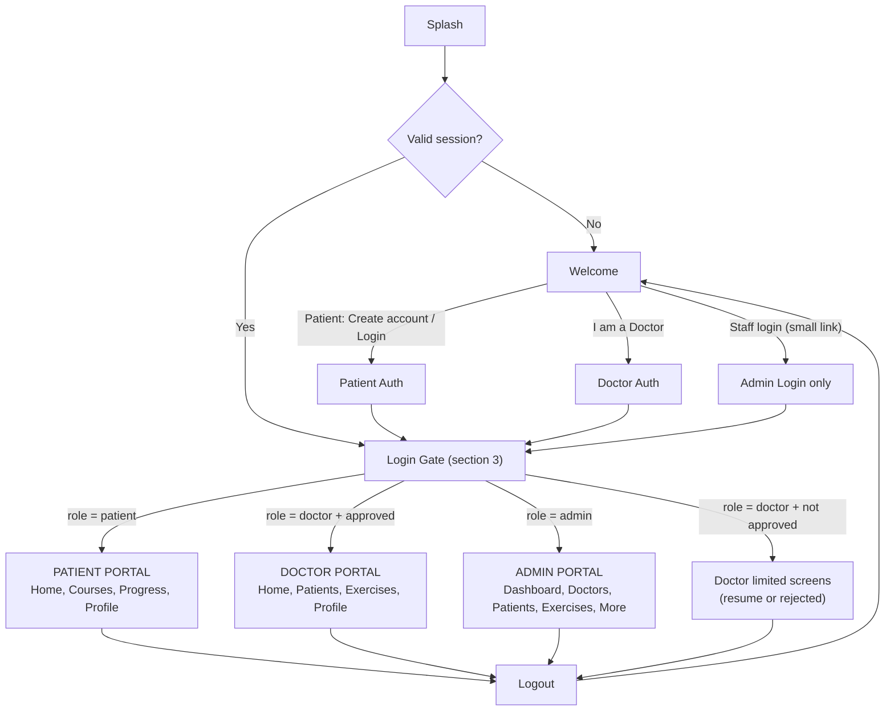
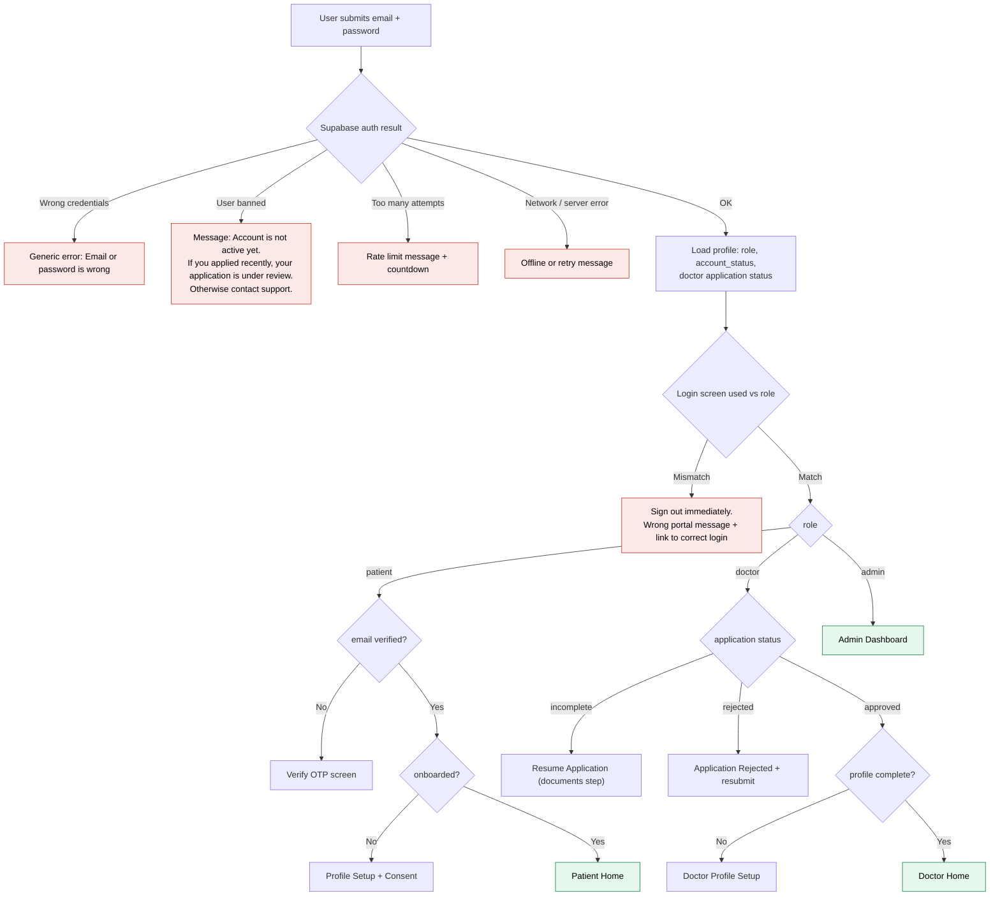
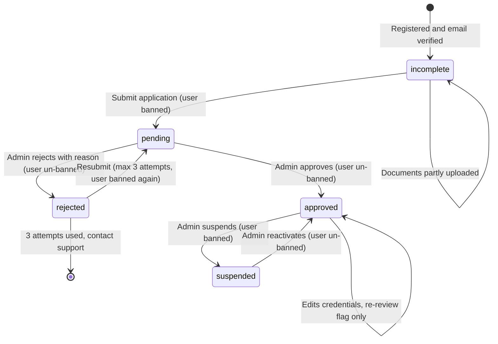
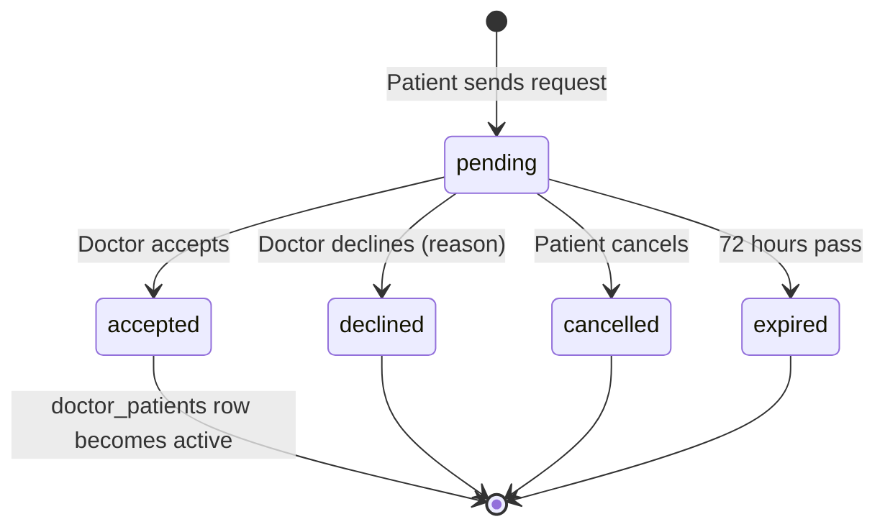
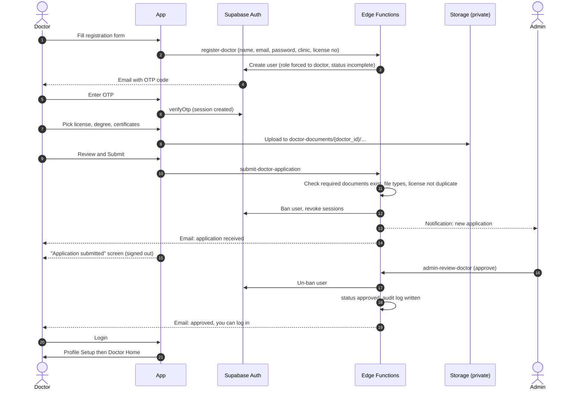
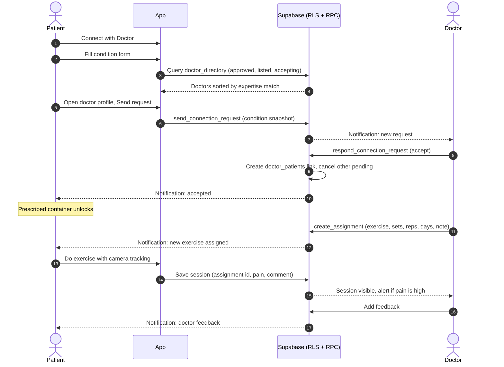
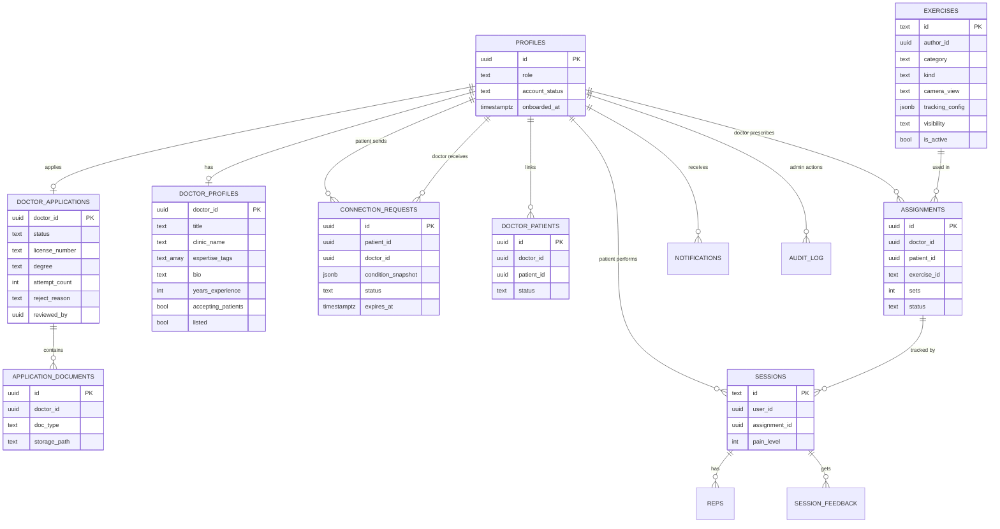
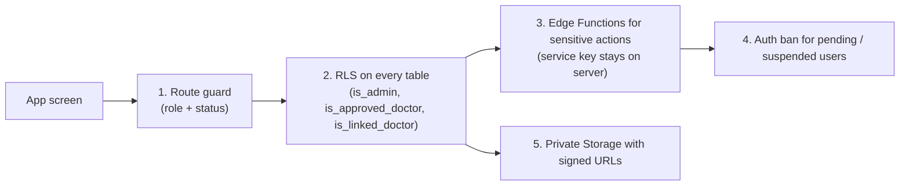

# RehabSense: System Overview (3 Portals)

> **Portals:** Admin, Doctor, Patient (one Flutter app, role-based routing)
> **Backend:** Supabase (Auth, Postgres + RLS, Storage, Edge Functions)
> **Companion files:** `ADMIN_PORTAL.md`, `DOCTOR_PORTAL.md`, `PATIENT_PORTAL.md`
> **Base:** `PROJECT_HANDOFF.md` (existing patient app and its screens stay as they are unless stated)

Diagrams are written in Mermaid. They render in GitHub, VS Code (Markdown Preview Mermaid extension), Notion, Obsidian and most AI tools.

---

## 1. Final decisions

| # | Topic | Decision |
|---|---|---|
| 1 | Portals | Three: **Admin**, **Doctor** (physio is the same role), **Patient**. |
| 2 | Admin signup | **None.** Admin accounts are created manually in Supabase and given `role = admin` by SQL. Admin only has Login. |
| 3 | Admin entry point | A small "Staff login" link on the Welcome screen. Not a main button. |
| 4 | Admin powers | Add, update, soft-delete doctors, patients (account level) and exercises. Review doctor applications. Create public exercises. Common screens (profile, password, notifications, logout). |
| 5 | Doctor signup | Public registration with **license, degree and certificate documents**. |
| 6 | Doctor login before approval | **Not possible.** A pending doctor is blocked at the auth level (Supabase user ban) until the admin approves. |
| 7 | Email verification | Same OTP-code flow the app already uses. |
| 8 | Doctor profile | After approval the doctor sets up profile: expertise tags, bio, experience, clinic. |
| 9 | Patient to doctor | Patient fills a condition form, sees doctors matched by expertise, sends a request. Doctor accepts or declines. |
| 10 | Prescribed exercises | Prescribed container is always visible but **locked until a doctor is connected**. Doctor assigns exercises from the library or his own new ones. |
| 11 | Patient without doctor | Fully usable (Wellness/Yoga and Rehab library, tracking, progress). |
| 12 | Tracking | 2D only (x, y angles). Exercise has a camera view (Side or Front). Types: rep and hold. No video stored. |
| 13 | Deletes | **Soft delete only** (archive / disable). Hard delete is manual SQL. |
| 14 | One email, one role | A patient email cannot be reused as a doctor email. |

---

## 2. Portal map (whole app)

---

## 3. Login Gate (runs after every successful login and on every app start)

Note: a **pending** doctor never reaches the "OK" branch because the auth user is banned. A **rejected** doctor is un-banned so he can see the reason and resubmit, but RLS gives him access to nothing except his own application.

---

## 4. Status model

| Field | Values | Who changes it |
|---|---|---|
| `profiles.role` | `patient`, `doctor`, `admin` | Server only (signup trigger sets `patient`; Edge Function sets `doctor`; SQL sets `admin`) |
| `profiles.account_status` | `active`, `disabled` | Admin via Edge Function |
| `doctor_applications.status` | `incomplete`, `pending`, `rejected`, `approved` | Edge Functions only |
| `connection_requests.status` | `pending`, `accepted`, `declined`, `expired`, `cancelled` | RPC functions only |
| `doctor_patients.status` | `active`, `ended` | RPC functions only |

### 4.1 Doctor application state machine

### 4.2 Connection request state machine

---

## 5. Key sequences

### 5.1 Doctor registration to first login

### 5.2 Patient request to prescribed exercise

---

## 6. Data model

---

## 7. Security layers

| Rule | Why |
|---|---|
| Role is never read from signup metadata | Anyone could send `role: doctor` |
| `guard_profile_protected_cols` trigger | Logged-in users cannot change `role` or `account_status` |
| `is_approved_doctor()` in every doctor policy | A rejected or incomplete doctor can log in but sees nothing |
| Documents bucket is private, access via short-lived signed URLs (60 s) | License and degree files are sensitive |
| Admin sees patient **account info only**, not sessions or condition | Privacy of health data |
| Every admin action writes `audit_log` | Accountability |
| Service key only in Edge Functions | Never inside the app |

---

## 8. Edge Functions and RPCs

| Name | Caller | Server checks | Effect |
|---|---|---|---|
| `register-doctor` | Public | Email not already used, password rules, rate limit | Creates auth user, role `doctor`, application `incomplete` |
| `submit-doctor-application` | Doctor (incomplete or rejected) | Required docs exist, file type and size, license number not duplicate, attempts under 3 | Status `pending`, ban user, notify admin |
| `admin-review-doctor` | Admin | Caller is admin, application is `pending` | Approve: un-ban, `approved`. Reject: un-ban, `rejected` + reason. Email + audit log |
| `admin-set-account-status` | Admin | Caller is admin, target is not self | Suspend or reactivate doctor or patient (DB status + auth ban) |
| `admin-add-doctor` (optional) | Admin | Caller is admin, email unused | Invite email, doctor pre-approved (admin vouches) |
| `get-document-url` | Admin or owning doctor | Role check | 60 second signed URL |
| `send_connection_request` | Patient | No active doctor, under 3 pending, doctor listed and accepting | Creates request |
| `respond_connection_request` | Doctor | Own request, pending, capacity | Accept creates link and cancels the patient's other pending requests |
| `end_connection` | Patient or linked doctor | Part of the link | Link ended, assignments paused |
| `create_assignment` | Linked approved doctor | Patient linked, exercise active, dates valid | Creates assignment and notification |
| `expire_requests` (cron, hourly) | System | `expires_at` passed | `pending` becomes `expired` |
| `purge_rejected_documents` (cron, daily) | System | Rejected for more than 30 days | Deletes files from storage |

---

## 9. Notifications and emails

| Event | To | Channel |
|---|---|---|
| New doctor application | Admin | In-app |
| Application received | Doctor | Email |
| Application approved | Doctor | Email + (on login) in-app |
| Application rejected + reason | Doctor | Email |
| Doctor suspended | Doctor (email), linked patients (in-app) | Email, in-app |
| New connection request | Doctor | In-app |
| Request accepted / declined / expired | Patient | In-app |
| New assignment / plan updated | Patient | In-app |
| Doctor feedback | Patient | In-app |
| Pain 7 or more reported | Doctor | In-app |
| No session for 3 days | Doctor | In-app |
| Patient disconnected | Doctor | In-app |

Production note: Supabase's default email service is very limited. Configure a custom SMTP provider before testing with real users.

---

## 10. Storage

| Bucket | Visibility | Who can write | Who can read |
|---|---|---|---|
| `doctor-documents` | Private | The doctor, only while status is `incomplete` or `rejected` | The doctor (own folder), admin |
| `avatars` (phase 2) | Private | Owner | Owner, linked users |

Document rules: PDF, JPG, PNG only. 5 MB max per file. License and degree are required, certificates optional (up to 3). The Edge Function checks the real file type, not only the extension.

---

## 11. Extra improvements added to your idea

| # | Improvement | Benefit |
|---|---|---|
| 1 | Pending doctor blocked by auth ban, not only by hiding screens | Truly cannot log in until approved |
| 2 | `incomplete` status and resume screen | A doctor who closes the app mid-registration can continue |
| 3 | 3 resubmission attempts | Stops spam |
| 4 | Duplicate license number check | One license cannot create many doctors |
| 5 | Rejected documents auto-deleted after 30 days | Privacy and storage cost |
| 6 | Verified badge on doctor profile | Patient trust (means documents were checked, not a medical guarantee) |
| 7 | Editing license or degree later triggers re-review but the doctor stays active meanwhile | Keeps credentials trustworthy |
| 8 | Audit log | Dispute handling |
| 9 | Admin cannot see patient sessions or conditions | Health data privacy |
| 10 | Soft delete everywhere | Sessions and assignments never break |
| 11 | Optional admin MFA (TOTP) in phase 2 | Admin account is the most valuable target |
| 12 | Doctor suspended mid-way: patients notified, old assignments stay viewable until end date | Patients are not left confused |
| 13 | Safety Alert for red-flag symptoms in the condition form | Clinical safety |

---

## 12. Build phases

| Phase | Work | Result |
|---|---|---|
| 0 | Custom SMTP, auth redirect and deep links, storage bucket | Emails and uploads work |
| 1 | Roles, statuses, guard trigger, RLS helpers, router redirect, move patient data from in-memory seed to Supabase | Foundation |
| 2 | Admin account (SQL), Admin Login, Dashboard shell | Admin can enter |
| 3 | Doctor registration, documents, submit, ban, admin review, approve and reject | Doctor onboarding works end to end |
| 4 | Doctor profile setup, directory view | Doctors appear to patients |
| 5 | Patient condition form, request flow, doctor accept and decline | Connection works |
| 6 | Assign exercise, prescribed container, pain report, feedback | Core clinical loop |
| 7 | Config-based tracking (rep and hold), exercise builder, yoga poses | Doctor and admin can create exercises |
| 8 | Admin management screens (doctors, patients, exercises, audit log) | Admin complete |
| 9 | Polish, empty and error states, full test pass | Demo ready |

---

## 13. Test cases (must pass)

| # | Test | Expected |
|---|---|---|
| 1 | Pending doctor tries to log in | Blocked, inactive-account message |
| 2 | Doctor closes app after OTP, before documents | Next login shows Resume Application |
| 3 | Rejected doctor logs in | Only the rejected screen, no doctor data |
| 4 | Rejected doctor resubmits 4 times | 4th attempt refused |
| 5 | Patient token calls `admin-review-doctor` | 403 |
| 6 | Doctor token calls `admin-review-doctor` | 403 |
| 7 | Client updates own `role` | Rejected by trigger |
| 8 | Patient opens a doctor document URL | Denied |
| 9 | Unapproved doctor reads any patient data | Empty |
| 10 | Admin reads a patient's sessions | Empty |
| 11 | Duplicate license number on second doctor | Refused |
| 12 | Doctor suspended while patients linked | Patients notified, no new assignments |
| 13 | Patient has 3 pending requests, sends a 4th | Refused |
| 14 | Two admins review the same application | Only the first succeeds |
| 15 | Patient email used in doctor registration | Refused with clear message |
